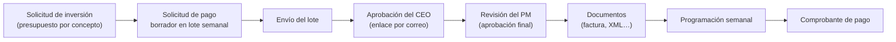

# Payment Request — Mapa del proyecto

Portal interno para **planear, solicitar, aprobar, programar y comprobar pagos de inversión** por proyecto, concepto y departamento, con control de presupuesto, aprobaciones por correo y un panel de administración. Hecho con Laravel 12 + Inertia v2 (React 19) + Filament 3.

> [!info] Cómo usar esta bóveda
> - Empieza por el [[Flujo de pago de inversion]]: es el proceso central del portal.
> - Cada nota termina con **Relacionado**; la vista de grafo muestra cómo se conectan.
> - Las rutas de código (`app/...`) apuntan a los archivos reales del repo.
> - Esta bóveda se mantiene con cada cambio al proyecto: ver [[#Cómo mantener la bóveda]].

## Proceso central en una mirada

## 01 · Arquitectura
[[Stack y versiones]] · [[Estructura de carpetas]] · [[Backend Laravel]] · [[Frontend Inertia React]] · [[Panel Filament]] · [[Autenticacion y 2FA]] · [[Colas y correo]] · [[Multimoneda]] · [[Zona horaria y locale]] · [[Seguridad de la aplicacion]]

## 02 · Módulos
**Inversión:** [[Solicitudes de inversion]] · [[Consolidado por proyecto]] · [[Solicitudes de pago de inversion]] · [[Lotes de pago]] · [[Aprobacion del CEO]] · [[Revision del PM]] · [[Documentos de pago]] · [[Programacion semanal]] · [[Comprobantes de pago]] · [[Estrategias]]

**Transversales:** [[Dashboards]] · [[Politica de ventanas de pago]] · [[Proyectos]] · [[Acceso por proyecto]] · [[Notificaciones in-app]] · [[Guia de usuario]] · [[Catalogos]]

**Legacy:** [[Modulo legacy Payment Requests]]

## 03 · Flujos
[[Flujo de pago de inversion]] · [[Flujo de solicitud de inversion]] · [[Presupuesto por concepto]] · [[Cancelacion automatica de borradores]] · [[Flujo legacy de solicitud de pago]]

## 04 · Datos
[[Modelo de datos]] · [[Estados]] · [[Enums]] · [[Migraciones]] · [[Auditoria y activity log]]

**Modelos principales:** [[InvestmentRequest]] · [[InvestmentPaymentRequest]] · [[InvestmentPaymentBatch]] · [[WeeklyPaymentSchedule]] · [[Strategy]] · [[Project]] · [[User]] — el resto está enlazado desde [[Modelo de datos]].

## 05 · Permisos
[[Roles y actores]] · [[Permisos Shield]] · [[Policies]] · [[Middleware y rutas protegidas]]

## 06 · Salidas
[[Catalogo de correos]] · [[PDFs]] · [[Exportaciones Excel]] · [[Rutas]]

## 07 · Integraciones
[[SAP Business One]] · [[Busqueda de proveedores]] · [[Comandos y scheduler]]

## 08 · Operación
[[Desarrollo local]] · [[Tests]] · [[Produccion]] · [[Deploy]] · [[Respaldos y restauracion]] · [[Correcciones de datos en produccion]] · [[Proteccion de la base de datos]] · [[APP_KEY y datos cifrados]]

## 09 · Decisiones y 10 · Historial
[[Indice de decisiones]] · [[Indice del historial]]

## Cómo mantener la bóveda

> [!warning] Regla obligatoria para personas y agentes
> **Cada modificación, ajuste o cambio al proyecto se documenta aquí en el mismo commit.** La regla completa (lista de verificación, formato y contenido prohibido) está en `AGENTS.md` en la raíz del repo, y `CLAUDE.md` la referencia.

1. Actualiza la nota del módulo, flujo, modelo, permisos o salida que cambió.
2. Si hubo una decisión, crea un ADR (plantilla `Plantillas/Plantilla decision`).
3. Agrega la entrada del cambio en el historial del mes (plantilla `Plantillas/Plantilla historial`).
4. Actualiza `actualizado:` en el frontmatter de cada nota que toques.

> [!danger] Nunca en la bóveda
> Contraseñas, tokens, `APP_KEY`, valores del `.env`, llaves SSH o sus rutas, nombres de personas reales, ni montos, folios o correcciones reales de producción. La bóveda se versiona en GitHub y se despliega al servidor.

Para abrirla: Obsidian → **Abrir carpeta como bóveda** → `payment-request/vault`.
