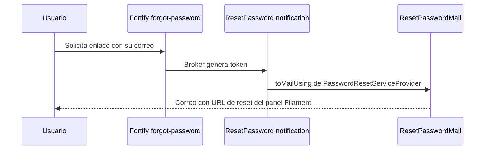

# Autenticación y 2FA

El portal Inertia autentica con **Laravel Fortify** (backend headless, vistas en React). El panel `/admin` usa el login propio de Filament. Ambos comparten el guard `web` y la misma tabla `users`.

## Configuración de Fortify (`config/fortify.php`)

| Clave | Valor | Efecto |
|---|---|---|
| `guard` / `passwords` | `web` / `users` | Guard de sesión estándar. |
| `username` / `email` | `email` | Login por correo. |
| `lowercase_usernames` | `true` | El correo se normaliza a minúsculas al autenticar (el modelo `User` también lo guarda en minúsculas con `setEmailAttribute`). |
| `home` | `/payment-requests` | Destino tras login. |
| `prefix` / `domain` | `''` / `null` | Rutas en la raíz (`/login`, `/logout`, `/forgot-password`, `/two-factor-challenge`, `/user/two-factor-authentication`, etc.). |
| `limiters` | `login`, `two-factor` | Definidos en `FortifyServiceProvider`. |
| `views` | `true` | Fortify registra las rutas GET de vistas (renderizadas con Inertia). |

### Features activas

| Feature | Estado |
|---|---|
| `resetPasswords()` | Activa |
| `emailVerification()` | Activa (ver advertencia) |
| `twoFactorAuthentication(['confirm' => true, 'confirmPassword' => true])` | Activa: requiere confirmar el código al habilitar y confirmar contraseña para gestionarla |
| `registration()` | **No activa**: no hay auto-registro. Los usuarios se crean desde el panel (`UserResource`). `CreateNewUser` y `pages/auth/register.tsx` quedan del starter kit sin ruta. |
| `updateProfileInformation()`, `updatePasswords()` | No activas en Fortify: perfil y contraseña se manejan con controllers propios en `Settings/`. |

## `FortifyServiceProvider`

- **Acciones**: `resetUserPasswordsUsing(ResetUserPassword)` y `createUsersUsing(CreateNewUser)`. Ambas validan con `PasswordValidationRules::passwordRules()` = `required|string|Password::default()|confirmed`.
- **Vistas Inertia**: `auth/login` (props `canResetPassword`, `canRegister`, `status`), `auth/reset-password`, `auth/forgot-password`, `auth/verify-email`, `auth/register`, `auth/two-factor-challenge`, `auth/confirm-password`.
- **Rate limiting**:
  - `login`: 5 intentos por minuto por `email|IP` (transliterado y en minúsculas).
  - `two-factor`: 5 intentos por minuto por `login.id` de sesión.
- **Logout**: respuesta personalizada que redirige a `/login`.

## Política de contraseñas

`AppServiceProvider` define `Password::defaults()`:
- **Producción**: mínimo 12 caracteres, mayúsculas y minúsculas, letras, números, símbolos y `uncompromised()` (consulta Have I Been Pwned).
- **Otros entornos**: sin regla adicional (`null`).

`config/auth.php`: los tokens de reset expiran a los 60 minutos con throttle de 60 s; `password_timeout` (re-confirmación) = `AUTH_PASSWORD_TIMEOUT`, por defecto 10800 s (3 h).

## Recuperación de contraseña

`PasswordResetServiceProvider` sobrescribe `ResetPassword::toMailUsing()` para **todos** los resets (portal y panel): la URL se genera con `Filament::getResetPasswordUrl($token, $notifiable)` y el correo usa `App\Mail\ResetPasswordMail` (asunto "Recuperación de Contraseña - {APP_NAME}", vista `emails.reset-password`, muestra la expiración configurada).

> [!question] Por confirmar
> Como la URL del correo apunta al flujo de reset de Filament (`/admin/...`), un usuario que pidió el enlace desde `/forgot-password` del portal termina restableciendo la contraseña en la pantalla del panel. Confirmar que es el comportamiento deseado y que funciona para usuarios sin permisos en el panel (el acceso a `/admin` solo exige `is_active`).

## Autenticación de dos factores (TOTP)

| Pieza | Detalle |
|---|---|
| Modelo | `User` usa `Laravel\Fortify\TwoFactorAuthenticatable`. Columnas `two_factor_secret`, `two_factor_recovery_codes`, `two_factor_confirmed_at` (migración `2025_08_14_170933_add_two_factor_columns_to_users_table`). Secret y códigos están ocultos en serialización y excluidos del activity log. |
| Página de ajustes | `GET /settings/two-factor` → `Settings\TwoFactorAuthenticationController::show` (middleware `password.confirm` aplicado vía `HasMiddleware` porque `confirmPassword = true`). Renderiza `settings/two-factor` con `twoFactorEnabled` y `requiresConfirmation`. |
| Request | `TwoFactorAuthenticationRequest` usa `InteractsWithTwoFactorState::ensureStateIsValid()` (limpia un alta a medias si el usuario abandonó la confirmación). |
| UI | `components/two-factor-setup-modal.tsx` (QR + código con `input-otp`), `components/two-factor-recovery-codes.tsx`, hook `use-two-factor-auth.ts`. |
| Login con 2FA | Si el usuario tiene 2FA confirmado, Fortify redirige a `/two-factor-challenge` (`pages/auth/two-factor-challenge.tsx`, acepta código TOTP o `recovery_code`). |
| Librerías | `pragmarx/google2fa` (TOTP) y `bacon/bacon-qr-code` (QR). |

> [!warning] Secretos 2FA cifrados con APP_KEY
> Fortify guarda `two_factor_secret` y `two_factor_recovery_codes` cifrados con `APP_KEY`. Cambiar la llave sin migrar los datos deja a los usuarios sin poder completar el 2FA (además de perder `branches.sap_password`). Ver [[APP_KEY y datos cifrados]].

> [!question] Por confirmar: alcance real del 2FA
> - El menú de ajustes (`layouts/settings/layout.tsx`) solo enlaza Perfil, Contraseña y Apariencia; la página de 2FA solo es accesible escribiendo `/settings/two-factor`.
> - El login de Filament (`/admin/login`) no pasa por el reto 2FA de Fortify y comparte el guard `web`: un usuario activo que entra por `/admin` queda autenticado también en el portal sin segundo factor.
> - El 2FA es opcional por usuario; no hay forma de exigirlo por rol.

## Verificación de correo

La feature `emailVerification()` está activa y las rutas del portal usan el middleware `verified`, pero `User` **no implementa** `MustVerifyEmail` (la interfaz está comentada en `app/Models/User.php`). En la práctica `verified` no bloquea a nadie.

## Estado activo / inactivo

`users.is_active` se usa en `User::canAccessPanel()` (panel) y en `scopeActive()`. El login del portal (Fortify) no define `authenticateUsing`, por lo que no revisa `is_active`.

> [!question] Por confirmar
> Un usuario marcado como inactivo (pero no eliminado) podría seguir iniciando sesión en el portal Inertia. Confirmar si se quiere bloquear también ahí (por ejemplo con `Fortify::authenticateUsing`).

## Ajustes de cuenta (`routes/settings.php`)

| Ruta | Middleware | Controller / vista | Nota |
|---|---|---|---|
| `GET /settings` | `auth` | redirect a `/settings/profile` | |
| `GET/PATCH /settings/profile` | `auth` | `ProfileController@edit/update` | Valida con `ProfileUpdateRequest` (`ProfileValidationRules`: nombre, correo único). Si cambia el correo, se limpia `email_verified_at`. |
| `DELETE /settings/profile` | `auth, verified` | `ProfileController@destroy` | Cierra sesión y hace `delete()` (soft delete por `SoftDeletes`). La página de perfil actual no muestra el componente `delete-user`. |
| `GET /settings/password` | `auth, verified` | `PasswordController@edit` | |
| `PUT /settings/password` | `auth, verified, throttle:6,1` | `PasswordController@update` | `PasswordUpdateRequest` (contraseña actual + nueva). |
| `GET /settings/appearance` | `auth, verified` | `settings/appearance` | Tema claro/oscuro/sistema. |
| `GET /settings/two-factor` | `auth, verified, password.confirm` | `TwoFactorAuthenticationController@show` | |

## Relacionado
- [[Seguridad de la aplicacion]] · [[Panel Filament]] · [[Roles y actores]] · [[Middleware y rutas protegidas]] · [[APP_KEY y datos cifrados]] · [[User]]
