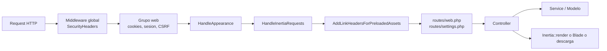

# Backend Laravel

Cómo está armado el lado servidor: arranque (`bootstrap/`), providers, middleware, capa de servicios, validación con FormRequests y el patrón de controllers que alimentan las páginas Inertia.

## Arranque: `bootstrap/app.php`

- **Ruteo**: `web: routes/web.php`, `commands: routes/console.php`, health check en `/up`. `routes/settings.php` se incluye con `require` al final de `web.php`.
- **Cookies sin cifrar**: `appearance` y `sidebar_state` (las lee el JS/servidor en claro).
- **Middleware global**: `SecurityHeaders` (`$middleware->append`) — aplica a todo, incluido Filament. Ver [[Seguridad de la aplicacion]].
- **Grupo `web`** (append): `HandleAppearance`, `HandleInertiaRequests`, `AddLinkHeadersForPreloadedAssets`.
- **Aliases**: `role`, `permission`, `role_or_permission` → middleware de `spatie/laravel-permission`. Ver [[Middleware y rutas protegidas]].
- **Excepciones**: `withExceptions` vacío; se usa el handler por defecto.

## Providers (`bootstrap/providers.php`)

| Provider | Responsabilidad |
|---|---|
| `AppServiceProvider` | `configureDefaults()`: `Date::use(CarbonImmutable::class)`; `DB::prohibitDestructiveCommands(app()->isProduction())` (bloquea `migrate:fresh`, `migrate:refresh`, `migrate:reset`, `migrate:rollback` y `db:wipe` en producción); `Password::defaults()` en producción = mínimo 12, mayúsculas/minúsculas, letras, números, símbolos y `uncompromised()`; fuera de producción no hay regla extra. |
| `Filament\AdminPanelProvider` | Panel `/admin`. Ver [[Panel Filament]]. |
| `FortifyServiceProvider` | Acciones, vistas Inertia de auth, rate limiters `login` y `two-factor`, y respuesta de logout que redirige a `/login`. Ver [[Autenticacion y 2FA]]. |
| `PasswordResetServiceProvider` | `ResetPassword::toMailUsing()` → construye la URL con `Filament::getResetPasswordUrl()` y envía `App\Mail\ResetPasswordMail` (vista `emails.reset-password`). |

## Middleware propio (`app/Http/Middleware`)

| Middleware | Qué hace |
|---|---|
| `HandleInertiaRequests` | `rootView = app`. Props compartidas: `name`; `auth.user` (id, name, email, avatar, `department_id`, `department_ids`, `departments`, `two_factor_confirmed_at`, `roles`); `sidebarOpen` (cookie); `unreadNotificationsCount`; `notifications` (closure lazy: últimas 10 no leídas con `title`, `body`, `status`, `created_at` relativo); `flash.success` / `flash.error`. |
| `HandleAppearance` | Comparte con Blade `appearance` (cookie, default `system`) para pintar modo oscuro sin parpadeo. |
| `SecurityHeaders` | Cabeceras de seguridad. Ver [[Seguridad de la aplicacion]]. |

> [!tip] Props compartidas tipadas
> El contrato TypeScript de estas props está en `resources/js/types/global.d.ts` (`InertiaConfig.sharedPageProps`). Si se agrega una prop compartida hay que actualizar ambos lados.

## Patrón de controllers

Los controllers viven en `app/Http/Controllers` y casi todos devuelven `Inertia::render()`. Coexisten tres estilos:

| Estilo | Cuándo se usa | Ejemplos |
|---|---|---|
| **Invocable** (`__invoke`, una acción) | Pantallas de solo lectura, descargas (PDF/Excel/documento) y endpoints puntuales | `DashboardController`, `InvestmentDashboardController`, `InvestmentSheetConsolidatedController`, `InvestmentSheetConsolidatedIndexController`, `*PdfController`, `*ExcelController`, `PaymentRequestDocumentController`, `DocumentViewController`, `ProviderSearchController`, `WeeklyPaymentScheduleExportController` |
| **Recurso** (`Route::resource`) | CRUD completo | `PaymentRequestController` (legacy), `InvestmentRequestController` (`investment-sheets`) |
| **Acciones nombradas** | Flujos con varios verbos | `EmailApprovalController` (`show/approve/reject`), `InvestmentBatchApprovalController` (`show/review/success`), `InvestmentPaymentRequestController` (`index/store/update/correctProvisionDate`), `InvestmentPaymentReviewController` (`index/submit`), `InvestmentPaymentBatchController` (`destroyPayment/submit`), `WeeklyPaymentScheduleController`, `NotificationController` |

Convenciones observadas:
- **Inyección por constructor** con property promotion de los servicios de aprobación (`InvestmentRequestController`, `PaymentRequestApprovalController`, `EmailApprovalController`, etc.).
- **Autorización** mezclada: `Gate::authorize('view', $model)` contra las [[Policies]] en descargas y detalle; `abort_unless(...)` para reglas de dominio (dueño del borrador, aprobación pendiente del usuario, proyecto abierto); middleware `role:` en rutas. Ver [[Middleware y rutas protegidas]] y [[Acceso por proyecto]].
- **Bloqueo por proyecto cerrado**: varios controllers repiten `abort_if($project !== null && ! $project->is_active, 403, 'Este proyecto está cerrado...')`. Ver [[Proyectos]].
- **Rutas con UUID**: pagos y lotes de inversión se resuelven por `{payment:uuid}` / `{batch:uuid}` para no exponer IDs incrementales.
- `Settings/TwoFactorAuthenticationController` usa la interfaz `HasMiddleware` para aplicar `password.confirm` solo a `show`.

## Validación: FormRequests

`app/Http/Requests` contiene los FormRequests de escritura: `StorePaymentRequestRequest`, `UpdatePaymentRequestRequest`, `RejectPaymentRequestRequest`, `StoreInvestmentRequestRequest`, `UpdateInvestmentRequestRequest`, `RejectInvestmentRequestRequest`, `StoreInvestmentPaymentRequest`, `UpdateInvestmentPaymentRequest`, `UploadInvestmentPaymentDocumentsRequest`, `UploadPaymentReceiptRequest`, `StoreWeeklyPaymentScheduleRequest` y los de `Settings/`.

- Reglas en **arreglo** (`['required', 'string', 'max:255']`) y `messages()` con textos en español.
- `authorize()` normalmente devuelve `true`; la autorización real ocurre en el controller.
- Validaciones de negocio en `withValidator()` / `after()`: tipos de documento por tipo de pago, saldo disponible del concepto normalizado a MXN (ver [[Presupuesto por concepto]] y [[Multimoneda]]), ventana de captura (ver [[Politica de ventanas de pago]]).
- Trait `Requests/Concerns/ResolvesInvestmentStrategy`: en `prepareForValidation()` resuelve la estrategia del pago y agrega reglas/mensajes/atributos (ver [[Estrategias]]).

> [!warning] Validación inline
> Algunos endpoints validan con `$request->validate([...])` dentro del controller en lugar de FormRequest: `PaymentRequestApprovalController` (folios SAP), `InvestmentPaymentBatchController::submit`, `InvestmentPaymentReviewController::submit`, `InvestmentBatchApprovalController::review`, `EmailApprovalController::reject`, `InvestmentPaymentRequestController::correctProvisionDate`, `InvestmentRequestController::updateDescription` y los filtros de los exports. Es deuda respecto a la guía del proyecto (FormRequest siempre).

## Capa de servicios (`app/Services`)

| Servicio | Responsabilidad |
|---|---|
| `ApprovalService` | Pipeline del módulo legacy: etapas `department` → `administration` (depto. ADMINISTRACIÓN) → `treasury` (depto. TESORERÍA) con niveles 1/2 por departamento; tokens por correo; guarda folios SAP al aprobar. Ver [[Flujo legacy de solicitud de pago]]. |
| `InvestmentApprovalService` | Aprobaciones de solicitudes de inversión, en este orden: si el proyecto tiene `requires_pm_approval` → una aprobación compartida notificada a todos los PMs; si no y `investment-requests.require_authorization` es `false` → auto-aprobación; si no → autorizador global (`investment-requests.authorizer_email`). Ver [[Flujo de solicitud de inversion]]. |
| `InvestmentPaymentApprovalService` | Aprobación individual de un pago de inversión con token. |
| `WeeklyPaymentScheduleApprovalService` | Aprobación de la programación semanal. Ver [[Programacion semanal]]. |
| `InvestmentDepartmentBreakdownService` | Desglose presupuesto/comprometido/pagado por departamento, normalizado a MXN. |
| `PaymentRequestPolicyService` | Motor de la política de ventanas (captura/envío, snooze, próxima fecha de provisión, payload para el frontend). Cachea la política 60 s. |
| `PaymentPolicySnoozeService` | Extiende/limpia ventanas temporalmente. |
| `PaymentPolicyAuditService` | Registra intentos bloqueados y extensiones en `payment_capture_attempt_logs`. |

Los servicios se resuelven por el contenedor (constructor) o con `app(...)`; `PaymentRequestPolicyService::fromCurrent()` es una fábrica estática.

## Otras piezas del backend

| Pieza | Dónde | Nota |
|---|---|---|
| Estados | `app/States/*` | `spatie/laravel-model-states`. Ver [[Estados]]. |
| API Resources | `app/Http/Resources/*` | Serializan solicitudes y aprobaciones (incluye URLs firmadas a documentos). |
| Activity log | Trait `LogsActivity` en modelos + `config/filament-logger.php` | Ver [[Auditoria y activity log]]. |
| Notificaciones | `app/Notifications/*` (todas `ShouldQueue`) | Ver [[Colas y correo]] y [[Catalogo de correos]]. |
| Exports / PDFs | `app/Exports/*`, `resources/views/pdf/*` | Ver [[Exportaciones Excel]] y [[PDFs]]. |
| Scheduler | `routes/console.php` | Ver [[Comandos y scheduler]]. |

## Relacionado
- [[Estructura de carpetas]] · [[Frontend Inertia React]] · [[Seguridad de la aplicacion]] · [[Rutas]] · [[Policies]] · [[Modelo de datos]]
