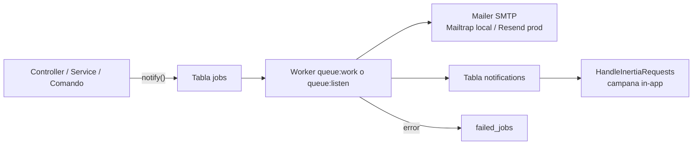

# Colas y correo

Todos los avisos del sistema (correo + campana in-app) se implementan como **Notifications de Laravel encoladas**. Si el worker de colas no está corriendo, no sale ningún correo ni aparece ninguna notificación in-app.

## Colas (`config/queue.php`)

| Clave | Valor | Nota |
|---|---|---|
| `default` | `QUEUE_CONNECTION`, por defecto `database` | Local usa `database`. |
| `connections.database` | tabla `jobs`, cola `default`, `retry_after` 90 s, `after_commit = false` | Tablas `jobs`, `job_batches` y `failed_jobs` creadas por `0001_01_01_000002_create_jobs_table`. |
| `failed.driver` | `database-uuids` (tabla `failed_jobs`) | Revisar con `php artisan queue:failed`; reintentar con `queue:retry`. |

- No hay clases `Job` propias: lo que se encola son las notificaciones (`ShouldQueue` + `Queueable`).
- Ninguna notificación define `$tries`, `backoff`, `onQueue` ni `afterCommit`: usan los valores del worker y la cola `default`.
- Caché (`config/cache.php`) y sesión (`config/session.php`) también usan driver `database` por defecto; el scheduler usa locks de caché para `withoutOverlapping()` (ver [[Comandos y scheduler]]).

### Worker

| Entorno | Cómo corre |
|---|---|
| Local | `composer dev` levanta `php artisan queue:listen --tries=1` junto con el servidor y Vite. Con Herd sirviendo el sitio, basta correr el worker y Vite. Ver [[Desarrollo local]]. |
| Producción | Ver [[Produccion]] y [[Deploy]]. |

> [!warning] `--tries=1` en local
> Con `queue:listen --tries=1` un error transitorio de SMTP manda el job directo a `failed_jobs` sin reintento.

## Correo (`config/mail.php`)

| Clave | Valor |
|---|---|
| `default` | `MAIL_MAILER` (default del archivo: `log`) |
| Mailers definidos | `smtp`, `ses`, `postmark`, `resend`, `sendmail`, `log`, `array`, `failover` (smtp → log), `roundrobin` (ses, postmark) |
| `smtp` | `MAIL_SCHEME`, `MAIL_URL`, `MAIL_HOST`, `MAIL_PORT`, `MAIL_USERNAME`, `MAIL_PASSWORD`, `MAIL_EHLO_DOMAIN` |
| Remitente | `MAIL_FROM_ADDRESS`, `MAIL_FROM_NAME` |
| `config/services.php` | `RESEND_API_KEY` (también `POSTMARK_API_KEY`, credenciales AWS, Slack) |

| Entorno | Proveedor |
|---|---|
| Local | SMTP a **Mailtrap sandbox** (los correos no llegan a destinatarios reales; se ven en la bandeja de Mailtrap). |
| Producción | **Resend**. |

> [!question] Por confirmar: transporte de Resend
> El mailer `resend` de Laravel necesita el paquete `resend/resend-php`, que **no** está en `composer.json`/`composer.lock`. Por lo tanto producción debe estar usando `MAIL_MAILER=smtp` apuntando al SMTP de Resend (con la API key como contraseña), no el transporte `resend` nativo. Confirmar y documentar en [[Produccion]].

## Notificaciones

19 clases en `app/Notifications`, **todas** `implements ShouldQueue`.

| Canales | Notificaciones |
|---|---|
| `database` + `mail` | `PaymentRequestCreated`, `PaymentRequestApproved`, `PaymentRequestCompleted`, `PaymentRequestRejected`, `PaymentRequestLevel2Rejected`, `InvestmentRequestCreated`, `InvestmentRequestApproved`, `InvestmentRequestCompleted`, `InvestmentRequestRejected`, `InvestmentRequestLevel2Rejected`, `InvestmentPaymentRequestCreated`, `WeeklyPaymentScheduleCreated` |
| `mail` + `database` (markdown propio) | `DraftPaymentsClosingSoonReminderNotification`, `DraftPaymentsAutoCancelledNotification`, `DraftPaymentsAutoCancelledPmSummaryNotification` |
| Solo `mail` (markdown propio) | `InvestmentBatchSubmittedNotification`, `InvestmentBatchReadyForReviewNotification`, `InvestmentBatchRequesterSummaryNotification`, `InvestmentBatchFinalApprovalSummaryToPmNotification` (esta adjunta un PDF con `attachData()`) |

Quién recibe qué y cuándo: [[Catalogo de correos]].

### Contenido del correo

- Las notificaciones de solicitudes usan el trait `Notifications/Concerns/IncludesRequestDetails` (`buildMailMessage()`), que arma el detalle, la etapa y los documentos con **URLs firmadas** a `documents.view`.
- Las que llevan token de aprobación enlazan a `/approval/{token}` con la leyenda "Este enlace es válido por 48 horas". Ver [[Seguridad de la aplicacion]].
- Plantillas: `resources/views/emails/*.blade.php` (`request-notification`, `investment-batch-*`, `final-approval-summary-pm`, `draft-payments-*`, `reset-password`) y el layout sobrescrito en `resources/views/vendor/mail` y `resources/views/vendor/notifications/email.blade.php`.

### Canal `database` (campana in-app)

- Tabla `notifications` (`2026_02_16_181342_create_notifications_table`).
- `toDatabase()` construye el payload con `Filament\Notifications\Notification::make()->...->getDatabaseMessage()`, que deja `title`, `body`, `status`, `icon` y `actions` en `data`.
- `HandleInertiaRequests` comparte `unreadNotificationsCount` y las 10 últimas no leídas (`title`, `body`, `status`, `created_at` relativo). Se marcan como leídas con `POST /notifications/{id}/read` y `POST /notifications/read-all`. Ver [[Notificaciones in-app]].

## Correo de recuperación de contraseña

`App\Mail\ResetPasswordMail` (Mailable) se envía desde `PasswordResetServiceProvider` vía `ResetPassword::toMailUsing()`. La notificación `ResetPassword` de Laravel no es `ShouldQueue`, así que este correo se envía **en la misma petición** (no depende del worker). Ver [[Autenticacion y 2FA]].

## Diagrama

## Relacionado
- [[Catalogo de correos]] · [[Notificaciones in-app]] · [[Comandos y scheduler]] · [[Produccion]] · [[Desarrollo local]] · [[Backend Laravel]]
