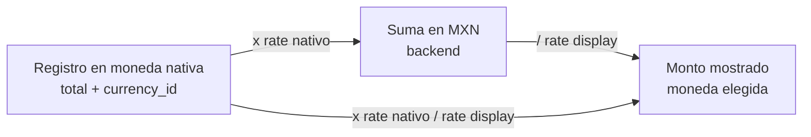

# Multimoneda

Convención para manejar montos en distintas monedas (MXN, USD, EUR, etc.) en el módulo de inversión: cada registro guarda su monto en **moneda nativa**, el backend **normaliza a MXN** para sumar y comparar, y el frontend **convierte a la moneda de visualización** elegida por el usuario.

## La convención en una línea

> [!important] `exchange_rate` = "1 unidad de esta moneda = X MXN"
> - MXN tiene `exchange_rate = 1`.
> - Ejemplo ficticio: USD con `exchange_rate = 18.5000` significa 1 USD = 18.50 MXN.

| Operación | Fórmula | Dónde |
|---|---|---|
| Nativo → MXN | `monto_nativo × rate_nativo` | Backend (SQL y PHP) |
| MXN → visualización | `monto_mxn ÷ rate_display` | `ResolvesDisplayCurrency::mxnToDisplay()` y `formatMxn()` en el frontend |
| Nativo → visualización | `monto_nativo × rate_nativo ÷ rate_display` | `convert()` del contexto `display-currency.tsx` |

Ejemplo ficticio: un pago de 1,000.00 USD (rate 18.5000) y visualización en EUR (rate 20.0000) → 1,000 × 18.5 = 18,500.00 MXN → 18,500 ÷ 20 = 925.00 EUR.

## Modelo de datos

| Elemento | Detalle |
|---|---|
| `currencies.exchange_rate` | `decimal(12,4)`, default `1`, cast `decimal:4` en [[Currency]]. Agregado en `2026_06_08_193000_add_exchange_rate_to_currencies_table`. |
| `currencies.name` / `prefix` | Se guardan en mayúsculas (mutators). `prefix` es el código (`MXN`, `USD`, ...). |
| `currency_id` en registros | Solicitudes de inversión, pagos de inversión y solicitudes legacy guardan su moneda nativa. |
| `projects.currency_id` | "Moneda por Defecto" del proyecto (`ProjectResource`, default MXN). Se usa como moneda de visualización inicial. Ver [[Proyectos]]. |
| Captura del tipo de cambio | `CurrencyResource` en el panel: campo "Tipo de cambio", numérico, `minValue(0)`, paso 0.0001. Es un valor **manual**; no hay integración con un proveedor de tipos de cambio ni histórico. |

> [!warning] Tipo de cambio vigente, no histórico
> Todas las conversiones usan el `exchange_rate` **actual** de la moneda (subconsulta a `currencies` en el momento de la consulta). Si se actualiza el tipo de cambio, cambian retroactivamente los saldos en MXN, el presupuesto disponible y los reportes de periodos pasados.

## Backend: normalización a MXN

Patrón SQL repetido (sumas por moneda de cada fila):

```sql
SUM(tabla.total * (select exchange_rate from currencies where currencies.id = tabla.currency_id))
```

| Lugar | Qué normaliza |
|---|---|
| `InvestmentRequest::budgetBreakdown()` / `sumPaymentsMxn()` | Presupuesto, comprometido, pagado y disponible del grupo proyecto + concepto + departamento. Única fuente del "saldo disponible". Ver [[Presupuesto por concepto]]. |
| `StoreInvestmentPaymentRequest` / `UpdateInvestmentPaymentRequest` | Convierte el `total` capturado a MXN (`total × rate`) antes de compararlo contra el disponible (en MXN). El mensaje de error muestra ambos montos en MXN. |
| `InvestmentDepartmentBreakdownService::for()` | Desglose por departamento (presupuesto, pagado, comprometido) en MXN. |
| `InvestmentSheetConsolidatedController` | `sumTotalMxn()` y totales por solicitud (`total × irRate`). Envía al frontend `currencies` (id, name, prefix, exchange_rate) y, por fila, `currency_id` nativo. Ver [[Consolidado por proyecto]]. |
| PDFs y Excel del consolidado | `InvestmentPaymentHistoryPdfController`, `InvestmentPaymentHistoryExcelController`, `InvestmentSheetInvestmentRequestsPdfController`, `InvestmentSheetInvestmentRequestsExcelController`. Ver [[PDFs]] y [[Exportaciones Excel]]. |

### Trait `ResolvesDisplayCurrency`

Usado por los cuatro controllers de reportes del consolidado:

| Método | Comportamiento |
|---|---|
| `resolveDisplayCurrency($request, $project)` | 1) `display_currency_id` del query string si existe; 2) moneda por defecto del proyecto; 3) la moneda con `prefix = 'MXN'` (`firstOrFail`). |
| `mxnToDisplay($mxn, $display)` | `$mxn / rate`; si `rate <= 0`, devuelve el monto MXN sin convertir. |
| `exchangeRateNote($display)` | Lista de todas las monedas con su tipo de cambio, para imprimir la nota de tipos de cambio en el reporte. |

El frontend agrega `display_currency_id` a las URLs de descarga (`consolidated.tsx`) para que el PDF/Excel salga en la moneda seleccionada.

## Frontend: moneda de visualización

`resources/js/contexts/display-currency.tsx` (provider montado para todas las páginas en `app.tsx`):

- Lee `currencies` y `project.currency_id` de las props de la página.
- Moneda inicial: la guardada en `localStorage` (clave `display-currency`) si es válida; si no, la del proyecto; si no, la primera de la lista.
- Funciones: `rateOf(id)` (si el rate es 0 o vacío usa 1), `convert(monto, idNativo)`, `format()` (nativo → display con prefijo), `formatMxn()` (MXN → display), `nativeNote()` (texto con el monto nativo cuando difiere de la moneda mostrada).
- Hook `useCurrencyFormatters()` envuelve esas funciones para las páginas.

El selector (`DisplayCurrencySelector` en `app-sidebar-header.tsx`) **solo aparece** en la página `investment-sheets/consolidated` y si hay al menos 2 monedas.



## Excepciones conocidas (no normalizan)

> [!question] Por confirmar: sumas sin tipo de cambio
> - `InvestmentDashboardController` (Control Presupuestal) suma `investment_requests.total` e `investment_payment_requests.total` **sin** multiplicar por `exchange_rate` (`sum('total')`). Con montos en varias monedas, los totales del dashboard mezclan monedas.
> - `WeeklyPaymentScheduleController` calcula `total_amount` de cada programación sumando `approved_amount ?? total` de pagos en distintas monedas sin convertir (cada pago sí muestra su `currency_prefix`).
> - El módulo legacy de solicitudes de pago no usa conversión.
> Confirmar si es intencional (por ejemplo, porque en la práctica todo es MXN) o si debe alinearse a la convención. Ver [[Dashboards]] y [[Programacion semanal]].

> [!warning] Tipo de cambio en cero
> El panel permite capturar `exchange_rate = 0`. En SQL esa moneda sumaría 0 MXN, mientras que el frontend trata 0 como 1 y `mxnToDisplay()` deja el monto sin convertir. Evitar capturar 0.

> [!note] Moneda distinta a la del proyecto
> Un pago puede estar en una moneda distinta a la moneda por defecto del proyecto (ej. proveedor nacional en un proyecto en EUR). Puede ser legítimo o un error de captura; no se asume ninguno de los dos.

## Relacionado
- [[Currency]] · [[Presupuesto por concepto]] · [[Consolidado por proyecto]] · [[PDFs]] · [[Exportaciones Excel]] · [[Frontend Inertia React]] · [[Catalogos]]
