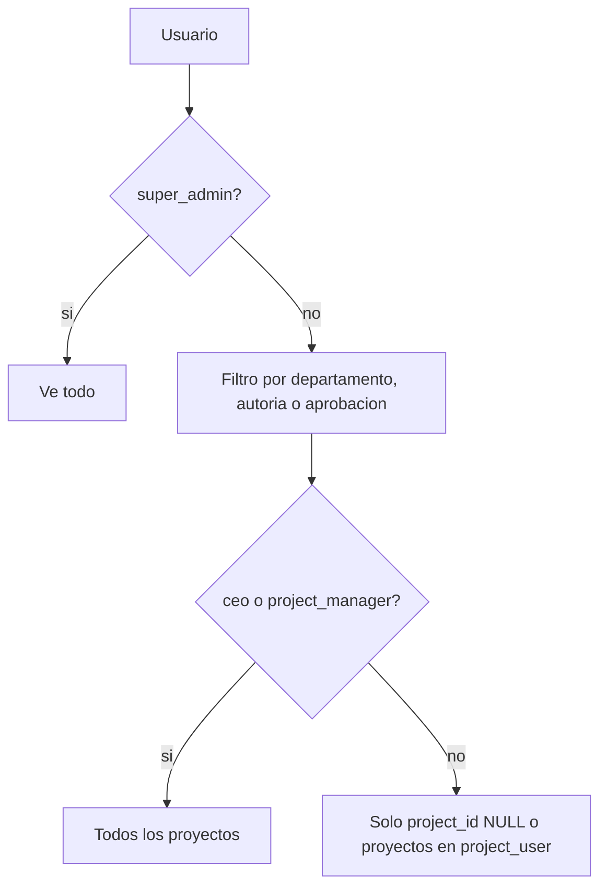

# Acceso por proyecto

Control que restringe **qué proyectos puede ver y capturar cada usuario**. Se asigna en Filament (sección "Proyectos autorizados" del usuario) y se guarda en la pivote `project_user`. Los roles `super_admin`, `ceo` y `project_manager` tienen acceso total sin asignación. Es una capa **adicional** (AND) sobre la visibilidad por departamento que ya existía.

> [!info] Excepción: consulta de Estrategias
> `/strategies` no aplica este control: la casilla `view_portal::strategies` da lectura de todas las Hojas y departamentos. Ver [[ADR-025 Consulta de Estrategias con permiso del portal]].

## Piezas

### Tabla `project_user`

Migración `2026_09_10_191942_create_project_user_table`: `id`, `project_id` y `user_id` (FKs con `cascadeOnDelete`), timestamps y `unique(project_id, user_id)`.

### Modelo `User`

| Método | Comportamiento |
|---|---|
| `projects()` | `belongsToMany(Project)` con timestamps. |
| `hasElevatedAccess()` | `true` si tiene rol `super_admin`, `ceo` o `project_manager`. |
| `canAccessProject(?Project)` | `true` si el proyecto es `null` (solicitudes históricas sin proyecto), si tiene acceso elevado o si el proyecto está en `projects()`. |

### Modelo `Project`

- `users()`: relación inversa.
- `scopeAccessibleBy(User)`: sin filtro para acceso elevado; para el resto, `whereIn('projects.id', $user->projects()->pluck(...))`.

### `InvestmentRequest::scopeVisibleTo()`

Orden de filtros:

1. `super_admin` → sin filtro.
2. Filtro por **departamento / autoría / aprobación**: solicitudes propias, de departamentos donde el usuario pertenece (pivote `department_user`) o es autorizador nivel 1/2, o donde tiene una aprobación.
3. Filtro AND por **proyecto** (excepto `ceo` y `project_manager`): `project_id IS NULL` **o** `project_id` dentro de los proyectos autorizados del usuario.

Como todo lo que lista solicitudes, pagos y agregados de inversión pasa por este scope, la restricción se propaga a consolidado, revisión de pagos, programación semanal, dashboards y reportes.

> [!info] `PaymentRequest` (legacy) no tiene `project_id`
> El scope `PaymentRequest::scopeVisibleTo()` no se modificó; el [[Modulo legacy Payment Requests]] solo se filtra por departamento.

## Administración (Filament `UserResource`)

Sección "Proyectos autorizados": `Select` múltiple, con búsqueda y precarga, ligado a la relación `projects`. Texto de ayuda: el usuario solo verá y capturará en los proyectos seleccionados; sin proyectos asignados no verá ningún proyecto en el portal.

- La sección se muestra al **crear** un usuario y al editar uno que **no** tenga rol `super_admin`, `ceo` ni `project_manager` (para ellos es irrelevante).
- En la tabla hay una columna "Proyectos autorizados" (badges separados por coma), oculta por defecto.

## Backfill inicial

Migración `2026_09_10_192000_backfill_project_user_from_departments` (corre una vez al desplegar la funcionalidad):

1. Toma a todos los usuarios **sin** rol `super_admin`, `ceo` ni `project_manager`.
2. Junta sus departamentos (pertenencia en `department_user` + departamentos donde son autorizador nivel 1 o 2).
3. Busca los proyectos donde esos departamentos ya tenían al menos una Solicitud de Inversión.
4. Asigna esos proyectos con `syncWithoutDetaching` (idempotente: no duplica si se vuelve a correr).

Objetivo: que nadie pierda acceso a los proyectos donde ya operaba. El `down()` es intencionalmente vacío (regla de no borrar registros); revertir la funcionalidad completa implica el rollback de la tabla. Ver [[Proteccion de la base de datos]] y [[Migraciones]].

> [!warning] Usuarios nuevos
> El backfill fue único. Un usuario creado después **no** recibe proyectos automáticamente: hay que asignarlos en Filament o no verá ningún proyecto.

## Guards contra fuga de datos

### Endpoints con `{project}` en la URL

Responden **403 "No tienes acceso a este proyecto."** con `abort_if(! $user->canAccessProject($project), 403, …)`:

| Controller | Ruta |
|---|---|
| `InvestmentSheetConsolidatedController` | `GET /investment-sheets/consolidated/{project}` |
| `InvestmentPaymentHistoryPdfController` | `…/{project}/payment-history-pdf` |
| `InvestmentPaymentHistoryExcelController` | `…/{project}/payment-history-excel` |
| `InvestmentSheetInvestmentRequestsPdfController` | `…/{project}/investment-requests-pdf` |
| `InvestmentSheetInvestmentRequestsExcelController` | `…/{project}/investment-requests-excel` |

`WeeklyPaymentScheduleExportController` recibe `project_id` por query y exige que exista al menos una solicitud del proyecto visible para el usuario (`visibleTo`), si no responde 403.

### Listados de proyectos

Filtran con `accessibleBy($user)`:

- `InvestmentDashboardController` (Control Presupuestal).
- `InvestmentSheetConsolidatedIndexController` (Hojas de Inversión).
- `InvestmentRequestController::create` y `::edit` (encadenado con `active()`, ver [[Proyectos]]).

`InvestmentPaymentReviewController::index` y `WeeklyPaymentScheduleController::index` construyen su lista de proyectos a partir de `InvestmentRequest::visibleTo($user)`, que ya incluye el filtro por proyecto.

## Huecos detectados en el código

> [!question] Por confirmar: `GET /investment-payment-requests/{investmentRequestId}`
> `InvestmentPaymentRequestController::index()` hace `InvestmentRequest::findOrFail($id)` y devuelve en JSON los pagos y el resumen presupuestal del concepto **sin** verificar `Gate`, `visibleTo` ni `canAccessProject`. Cualquier usuario autenticado que conozca un ID numérico podría consultarlo.

> [!question] Por confirmar: proyecto en la captura de Solicitudes de Inversión
> `StoreInvestmentRequestRequest` valida `project_id` solo con `exists:projects,id`, y `InvestmentRequestController::store()` verifica que esté abierto pero no que el usuario tenga acceso. El formulario solo ofrece proyectos accesibles, pero un POST manipulado podría usar otro proyecto.

> [!question] Por confirmar: policy de Solicitudes de Inversión
> `InvestmentRequestPolicy::hasAccess()` (usada por `show`, `edit`, `update`, `destroy` y el PDF) permite el acceso por autoría, por ser autorizador del departamento o por tener una aprobación, **sin** revisar el proyecto. Un autorizador de departamento podría abrir por URL directa una solicitud de un proyecto no asignado.

> [!question] Por confirmar: panel Filament
> `InvestmentRequestResource::getEloquentQuery()` filtra por departamento autorizado / aprobaciones / autoría, pero no aplica el filtro por proyecto.

## Relacionado
- [[Proyectos]] · [[User]] · [[Project]] · [[InvestmentRequest]]
- [[Roles y actores]] · [[Policies]] · [[Middleware y rutas protegidas]] · [[Seguridad de la aplicacion]]
- [[Consolidado por proyecto]] · [[Dashboards]] · [[Catalogos]]
