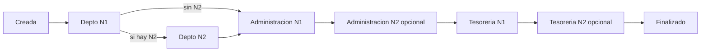

# Módulo legacy Payment Requests

Primer módulo del portal (febrero–abril 2026): **Solicitudes de Pago** generales (no ligadas a proyectos de inversión) con un flujo secuencial de autorización Departamento → Administración → Tesorería, aprobación por correo con token y captura de **folios SAP**. Sigue activo en `/payment-requests` y en Filament (`/admin/payment-requests`, grupo "Operaciones"), pero el trabajo actual del portal se concentra en el flujo de inversión.

## Modelo `PaymentRequest`

| Campo | Notas |
|---|---|
| `uuid` | Se genera en `creating`; es la llave de ruta (`getRouteKeyName()`). |
| `folio_number` | Consecutivo: `max(folio_number)` incluyendo borrados lógicos + 1 (`booted()`). |
| `provider`, `rfc`, `invoice_folio`, `description` | Se guardan en MAYÚSCULAS. RFC alfanumérico de 12–13 caracteres, opcional. |
| `user_id`, `department_id` | Solicitante y departamento (del formulario si el usuario tiene varios; si no, su departamento principal). |
| `currency_id`, `branch_id`, `expense_concept_id`, `payment_type_id` | Catálogos (ver [[Catalogos]]). Tipos de pago solo de categoría `payment`. |
| `advance_documents` | Arreglo JSON de rutas en disco `local` (`advance-documents/AAAA/MM/{folio}/{uuid}.ext`). |
| `subtotal`, `iva_rate` (`IvaRate`: 0 %, 4 %, 8 %, 10 %, 16 %, 21 %), `iva`, `retention`, `total` | Montos. |
| `number_purchase_invoices` | **Folio SAP Factura Proveedores** (etapa Administración). |
| `number_vendor_payments` | **Folio SAP Pago Efectuado** (etapa Tesorería). |
| `status` | Estado Spatie `PaymentRequestState`. |

Usa `SoftDeletes` y `LogsActivity`. Relaciones: `user`, `department`, `currency`, `branch`, `paymentType`, `expenseConcept`, `approvals` (`PaymentRequestApproval`). Ver [[PaymentRequest]] y [[PaymentRequestApproval]].

### Estados

| Clase | `$name` | Etiqueta |
|---|---|---|
| `PendingDepartment` (default) | `pending_department` | Pendiente Departamento |
| `PendingAdministration` | `pending_administration` | Pendiente Administración |
| `PendingTreasury` | `pending_treasury` | Pendiente Tesorería |
| `Completed` | `completed` | Finalizado |

Transiciones permitidas solo hacia adelante (`PaymentRequestState`). No existe estado de rechazo. Ver [[Estados]].

## Flujo de autorización (`ApprovalService`)

Pipeline fijo en `ApprovalService::PIPELINE`:

| Etapa | Departamento responsable | Siguiente estado |
|---|---|---|
| `department` | El departamento de la solicitud | `pending_administration` |
| `administration` | Departamento con nombre exacto `ADMINISTRACIÓN` | `pending_treasury` |
| `treasury` | Departamento con nombre exacto `TESORERÍA` | `completed` |

- **Creación** (`createApprovals`): crea la aprobación `department` nivel 1 para el `authorizerLevel1` del departamento, con token UUID válido 48 h, y notifica `PaymentRequestCreated`.
- **Aprobar** (`approve`): marca la aprobación, guarda folios SAP si vienen en `$data`; si es nivel 1 y el departamento tiene `authorizer_level_2_id`, crea la aprobación nivel 2 y notifica `PaymentRequestApproved`; si no, transiciona al siguiente estado y crea la aprobación nivel 1 de la siguiente etapa (`PaymentRequestApproved`). Al llegar a `completed` notifica al solicitante `PaymentRequestCompleted`.
- **Rechazar nivel 1**: guarda comentarios y notifica al solicitante `PaymentRequestRejected`.
- **Rechazar nivel 2**: crea una nueva aprobación nivel 1 pendiente (token nuevo, 48 h), notifica al autorizador nivel 1 `PaymentRequestLevel2Rejected` y al solicitante `PaymentRequestRejected`.

Los departamentos de Administración y Tesorería se buscan por nombre; si no existen o no tienen autorizador, la solicitud avanza de estado pero no se crea aprobación (queda sin responsable).

> [!question] Por confirmar
> Un rechazo de nivel 1 no cambia el estado ni crea una aprobación nueva: la solicitud queda en su estado "Pendiente …" sin aprobador pendiente y sin forma de reactivarla desde la UI. Confirmar si este es el comportamiento esperado.

Detalle del flujo en [[Flujo legacy de solicitud de pago]].

## Portal Inertia

| Método | URI | Acción | Autorización |
|---|---|---|---|
| GET | `/payment-requests` | `index`: lista paginada (15) con búsqueda (proveedor, folio factura, folio), filtro de estado y grupo `pending` (default) / `completed` / todos | Solo `visibleTo($user)`; **sin** `Gate` |
| GET | `/payment-requests/create` | Formulario | Sin `Gate` |
| POST | `/payment-requests` | `store` (FormRequest `authorize()` = `true`) + `createApprovals` | Sin `Gate` |
| GET | `/payment-requests/{uuid}` | `show` | `Gate::authorize('view')` |
| GET/PUT/PATCH | `/payment-requests/{uuid}/edit`, `/payment-requests/{uuid}` | Editar; solo en `pending_department`. Si se suben archivos nuevos, se **borran del disco** los anteriores | `Gate::authorize('update')` |
| DELETE | `/payment-requests/{uuid}` | Soft delete | `Gate::authorize('delete')` |
| POST | `/payment-requests/{uuid}/approve` | `PaymentRequestApprovalController::approve` (acepta folios SAP), `throttle:10,1` | Debe tener aprobación `pending` |
| POST | `/payment-requests/{uuid}/reject` | `reject`, comentario mínimo 10 caracteres, `throttle:10,1` | Debe tener aprobación `pending` |
| PATCH | `/payment-requests/{uuid}/sap-folios` | `updateSapFolios` | Solo quien aprobó la etapa `administration` (folio factura) o `treasury` (folio pago) |
| GET | `/payment-requests/{uuid}/pdf` | PDF, solo `completed` | `Gate::authorize('view')` |
| GET | `/payment-requests/{uuid}/documents/{index}` | Descarga/visualiza adjunto | `Gate::authorize('view')` |

`PaymentRequestPolicy` combina el permiso Shield (`view_payment::request`, `update_payment::request`, …) con `hasAccess()`: super_admin, solicitante, autorizador del departamento o usuario con alguna aprobación.

### Aprobación por correo

`/approval/{token}` (`EmailApprovalController`, `throttle:10,1`) busca el token en `PaymentRequestApproval`, `InvestmentRequestApproval`, `InvestmentPaymentApproval` y `WeeklyPaymentScheduleApproval`; valida vigencia (48 h) y estado, y llama al servicio correspondiente. No requiere sesión. Ver [[Rutas]].

### Por qué Shield no oculta el menú

> [!warning] Menú fijo y sin control de permisos
> - En `resources/js/components/app-sidebar.tsx` el grupo "Solicitudes" → "Solicitudes de Pago" (`/payment-requests`) está **fijo en el código** y se muestra a todos los usuarios autenticados; no consulta roles ni permisos.
> - `PaymentRequestController::index()` (y `create` / `store`) no llama a `Gate::authorize('viewAny' | 'create')`; solo aplica el scope `visibleTo`.
> - Por eso quitar los permisos Shield `view_any_payment::request` / `create_payment::request` a un rol **solo oculta el recurso en `/admin`**, no en el portal Inertia: el usuario sigue viendo el menú, la lista (de lo que `visibleTo` le permite) y puede crear solicitudes.
>
> Ver [[Permisos Shield]] y [[Middleware y rutas protegidas]].

## Panel Filament (`PaymentRequestResource`)

Grupo "Operaciones". Formulario con los mismos campos (incluye "Folio SAP Factura Proveedores" y "Folio SAP Pago Efectuado"), acciones de tabla **Aprobar** / **Rechazar** (visibles si el usuario tiene una aprobación pendiente) y **PDF** (solo `completed`). La creación desde Filament también llama a `ApprovalService::createApprovals()`.

## Salidas

- Correos: `PaymentRequestCreated`, `PaymentRequestApproved`, `PaymentRequestCompleted`, `PaymentRequestRejected`, `PaymentRequestLevel2Rejected` (canales `database` + `mail`, plantilla `emails.request-notification`). Ver [[Catalogo de correos]].
- PDF `pdf.payment-request` (compartido con Solicitudes de Inversión). Ver [[PDFs]].
- El [[Dashboards|Panel]] (`/dashboard`) solo muestra datos de este módulo.

## Relacionado
- [[Flujo legacy de solicitud de pago]] · [[PaymentRequest]] · [[PaymentRequestApproval]] · [[Estados]]
- [[SAP Business One]] · [[Catalogos]] · [[Permisos Shield]] · [[Policies]] · [[Rutas]] · [[Dashboards]]
