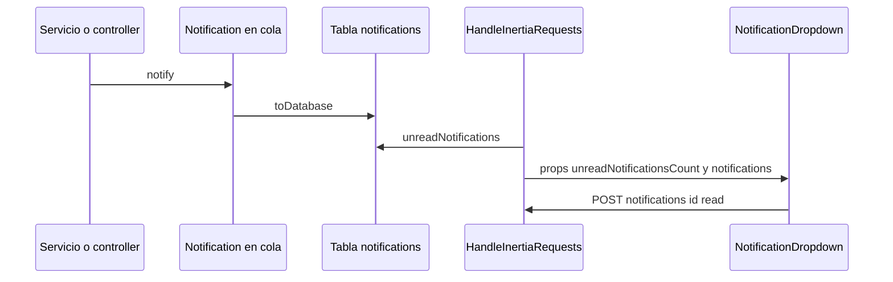

# Notificaciones in-app

Campana de notificaciones en el encabezado del portal Inertia. Muestra las notificaciones **no leídas** guardadas por el canal `database` de Laravel (tabla `notifications`) y permite marcarlas como leídas una por una o todas.

## Cómo funciona

### Props compartidas

`HandleInertiaRequests::share()` agrega a **todas** las páginas:

| Prop | Contenido |
|---|---|
| `unreadNotificationsCount` | `$user->unreadNotifications()->count()` (0 si no hay sesión). |
| `notifications` | Closure (se evalúa por request): las 10 no leídas más recientes, mapeadas a `id`, `title` (`data['title']`), `body` (`data['body']`), `status` (`data['status']`, default `info`) y `created_at` en formato relativo (`diffForHumans`). |

### Rutas y controller

| Método | URI | Nombre | Acción |
|---|---|---|---|
| POST | `/notifications/{id}/read` | `notifications.read` | `NotificationController::markAsRead()`: busca la notificación **entre las del usuario autenticado** (`$user->notifications()->findOrFail($id)`) y la marca como leída. |
| POST | `/notifications/read-all` | `notifications.read-all` | `NotificationController::markAllAsRead()`: marca todas las no leídas del usuario. |

Ambas dentro del grupo `auth` + `verified`; responden `back()`. Ver [[Rutas]].

### Componente `NotificationDropdown`

Montado en `app-sidebar-header.tsx`.

- Icono de campana con contador rojo (muestra `99+` arriba de 99).
- Encabezado "Notificaciones" y enlace "Marcar todas como leídas" si hay pendientes.
- Cada elemento muestra icono por `status` (`warning` ámbar, `danger` rojo, `success` verde, `info` azul), título, cuerpo truncado y tiempo relativo.
- Al hacer clic en un elemento se envía `POST /notifications/{id}/read` con `preserveScroll`. **No navega** a la URL de la acción de la notificación.
- Sin notificaciones: "No tienes notificaciones pendientes".

## Qué notificaciones llegan a la campana

Solo las clases cuyo `via()` incluye `database`. Detalle completo de disparadores y destinatarios en [[Catalogo de correos]].

| Clase | Formato del payload `database` | ¿Se ve bien en la campana? |
|---|---|---|
| `PaymentRequestCreated`, `PaymentRequestApproved`, `PaymentRequestCompleted`, `PaymentRequestRejected`, `PaymentRequestLevel2Rejected` | `FilamentNotification::make()->…->getDatabaseMessage()` (incluye `title`, `body`, `status`, `icon`, `actions`) | Sí |
| `InvestmentRequestCreated`, `InvestmentRequestCompleted`, `InvestmentRequestRejected` (y `InvestmentRequestApproved`, `InvestmentRequestLevel2Rejected`, sin uso hoy) | Filament database message | Sí |
| `InvestmentPaymentRequestCreated` (sin uso hoy), `WeeklyPaymentScheduleCreated` | Filament database message | Sí |
| `DraftPaymentsClosingSoonReminderNotification` | Arreglo propio: `type`, `count`, `closes_at` | **No**: no trae `title` ni `body` |
| `DraftPaymentsAutoCancelledNotification` | `type`, `count`, `window_closed_at`, `payments[]` | **No** |
| `DraftPaymentsAutoCancelledPmSummaryNotification` | `type`, `total_cancelled`, `window_closed_at`, `by_department_count` | **No** |

Las notificaciones de lotes de inversión (`InvestmentBatch*`) solo usan `mail`, no aparecen en la campana.

> [!question] Por confirmar
> Las tres notificaciones de la [[Politica de ventanas de pago]] guardan un arreglo sin `title`/`body`, por lo que en la campana aparecen como un elemento vacío con icono `info`. Confirmar si se desea adaptar su `toDatabase()` al formato de las demás.

> [!info] Acciones de Filament no se usan en el portal
> Las notificaciones con formato Filament incluyen una acción "Ver Solicitud" con URL (por ejemplo `/admin/investment-requests/{uuid}/edit` o `/investment-sheets/consolidated`), pero el dropdown de React ignora `actions`. Además, `AdminPanelProvider` no habilita `->databaseNotifications()`, así que el panel `/admin` tampoco muestra una campana.

## Relacionado
- [[Catalogo de correos]] · [[Colas y correo]] · [[Frontend Inertia React]] · [[Panel Filament]]
- [[Politica de ventanas de pago]] · [[Modulo legacy Payment Requests]] · [[Rutas]]
