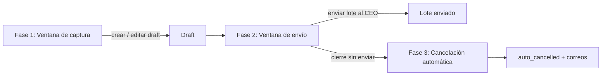

# Política de ventanas de pago

Regla operativa configurable que limita **cuándo** se pueden capturar (crear/editar) y **enviar** Pagos de Inversión, fija la **fecha de programación** del pago y, cuando la ventana de envío está activa, **cancela automáticamente** los borradores no enviados al cierre. Se administra desde el panel Filament en `/admin/payment-policy-settings` ("Política de Ventanas", grupo de navegación "Configuración").

Aplica únicamente a los Pagos de Inversión (`InvestmentPaymentRequest`); no afecta Solicitudes de Inversión ni el [[Modulo legacy Payment Requests|módulo legacy]].

## Las 3 fases

| Fase | Qué controla | Dónde se aplica | Si la ventana está apagada |
|---|---|---|---|
| 1. Captura | Crear y editar drafts de pago | `StoreInvestmentPaymentRequest::withValidator()` (acción `create`) y `UpdateInvestmentPaymentRequest::withValidator()` (acción `edit`) | Se puede capturar cualquier día |
| 2. Envío a autorización | Enviar el lote al CEO | `InvestmentPaymentBatchController::submit()` (acción `submit`) | Se puede enviar cualquier día |
| 3. Cancelación automática | Drafts no enviados al cierre de la ventana de envío pasan a `auto_cancelled` | Comando `payment-drafts:cancel-expired` | No hay cancelación (el comando sale sin hacer nada) |

Cuando una acción se bloquea, el backend responde con un error de validación en la llave `payment_policy` ("La ventana de captura está cerrada. Próxima apertura: …" / "La ventana de envío a autorización está cerrada…") y registra el intento con `PaymentPolicyAuditService::logBlockedAttempt()`.

La fase 3 se documenta a detalle en [[Cancelacion automatica de borradores]].

## Valores por defecto

`PaymentRequestPolicy::current()` devuelve el registro único (singleton) de la tabla `payment_request_policies`; si no existe, lo crea con estos valores:

| Campo | Default |
|---|---|
| `capture_window_is_active` | `true` |
| Captura abre / cierra | lunes 08:00 / miércoles 18:00 |
| `submit_window_is_active` | `false` (envío siempre abierto) |
| Envío abre / cierra | lunes 08:00 / miércoles 18:00 |
| `provision_target_day` | `tuesday` |
| `provision_target_week_offset` | `1` (semana siguiente) |
| `override_role_names` | `['super_admin']` |
| `editor_role_names` | `['super_admin', 'project_manager']` |
| `warning_minutes_before_close` | `5` |

Con los defaults, solo la ventana de captura está activa; el envío y por lo tanto la cancelación automática quedan apagados hasta que alguien active `submit_window_is_active`.

## Modelo `PaymentRequestPolicy`

Campos (`$fillable`): banderas y día/hora de apertura y cierre de cada ventana (`capture_*`, `submit_*`), `cancellation_activated_at`, `provision_target_day`, `provision_target_week_offset`, `override_role_names` y `editor_role_names` (arrays JSON), `warning_minutes_before_close`, campos de *snooze* (`capture_window_snoozed_until`, `capture_window_snooze_reason`, `submit_window_snoozed_until`, `submit_window_snooze_reason`) y `holidays` (array).

> [!info] `holidays`
> El campo `holidays` existe en el modelo pero no aparece en el formulario de Filament ni se consulta en `PaymentRequestPolicyService`. Hoy no tiene efecto.

Detalle del modelo en [[PaymentRequestPolicy (modelo)]].

## Página Filament `PaymentPolicySettings`

Página singleton (`Filament\Pages\Page` + `InteractsWithForms`, no un Resource), vista `filament.pages.payment-policy-settings`.

- **Acceso**: `canAccess()` permite solo a `super_admin` y `project_manager` (fijo en código).
- **Secciones del formulario**:
  1. *Ventana de Captura (Solicitar/Editar pagos)*: toggle + día/hora de apertura y cierre.
  2. *Ventana de Envío a Autorización*: toggle + día/hora; el texto advierte que activarla habilita la cancelación automática.
  3. *Fecha de Pago*: día objetivo y "Semanas adelante" (1–8).
  4. *Permisos y UX*: roles con override, roles editores (opciones fijas: Super Admin, CEO, Project Manager) y minutos de aviso antes del cierre (1–30).
  5. *Snooze (extensión temporal por emergencia)*: fecha/hora "extendida hasta" y motivo para cada ventana (sección colapsada).
- **Guardar** (`save()`):
  - Si se activa `submit_window_is_active` y `cancellation_activated_at` está vacío, lo marca con `now()`. Solo los drafts creados **después** de esa fecha son elegibles para cancelación automática.
  - Verifica `editor_role_names` (`abort_unless(... 403)`).
  - Actualiza el registro y limpia la caché (`PaymentRequestPolicyService::flushCache()`).

> [!warning] Dos controles de acceso distintos
> `canAccess()` está fijo a super_admin y PM, mientras que `save()` usa `editor_role_names`. Si se agrega `ceo` a los editores, el CEO seguiría sin poder abrir la página; si se quita `project_manager` de los editores, el PM podría abrirla pero no guardar.

## `PaymentRequestPolicyService`

Encapsula toda la lógica de ventanas. Se instancia con `PaymentRequestPolicyService::fromCurrent()`, que cachea la política 60 s (`Cache` llave `payment_request_policy`).

| Método | Qué hace |
|---|---|
| `isWithinCaptureWindow()` / `isWithinSubmitWindow()` | `true` si la ventana está inactiva, si hay snooze vigente o si "ahora" cae entre apertura y cierre de la semana. Soporta ventanas que cruzan semana (apertura posterior al cierre). |
| `canCaptureNow($user)` / `canSubmitNow($user)` | Override del usuario **o** dentro de ventana. |
| `getCurrentCaptureClosesAt()` / `getCurrentSubmitClosesAt()` | Cierre de esta semana; si ya pasó, el de la próxima. |
| `getNextCaptureOpensAt()` / `getNextSubmitOpensAt()` | Próxima apertura. |
| `userHasOverride($user)` | Rol en `override_role_names` (default `super_admin`). |
| `userCanEditPolicy($user)` | Rol en `editor_role_names`. |
| `getNextProvisionDate()` | Lunes de la semana ISO actual + N semanas → siguiente `provision_target_day`. |
| `buildFrontendPayload($user)` | Arma el payload `capture` / `submit` / `provision` / `warningMinutesBeforeClose` / `isOverride` para React. |

Zona horaria: todos los cálculos usan `config('app.timezone')` (ver [[Zona horaria y locale]]); los mensajes dicen "hora CDMX".

### Fecha de programación del pago

Al crear un pago, `StoreInvestmentPaymentRequest` exige que `payment_provision_date` sea exactamente `getNextProvisionDate()`. En el modal del consolidado el campo de fecha queda con `min` = `max` = esa fecha y muestra "Política operativa: pago el …".

> [!question] Por confirmar
> El mensaje de error de esa validación dice fijo "(martes de la siguiente semana)" aunque `provision_target_day` y `provision_target_week_offset` son configurables.

## Excepción de super_admin

- **Override de ventanas**: por default solo `super_admin` está en `override_role_names`, así que puede capturar, editar y enviar fuera de ventana. Su intento no se bloquea ni se registra.
- **Corrección de fecha de programación**: la ruta `PATCH /investment-payment-requests/{payment:uuid}/provision-date` (`investment-payment-requests.correct-provision-date`, middleware `role:super_admin`, más `abort_unless` en `InvestmentPaymentRequestController::correctProvisionDate()`) permite mover `payment_provision_date` y recalcular `payment_week_number` sin pasar por la validación de ventana ni de fecha objetivo. No toca el lote.

## Snooze (extensión temporal)

- Desde la página Filament se puede capturar directamente `*_snoozed_until` y su motivo.
- `PaymentPolicySnoozeService` ofrece `extendCaptureWindow()` / `extendSubmitWindow()` (extiende N horas sobre el cierre actual, valida `editor_role_names` y registra en el log con acción `snooze_extended`) y `clearCaptureSnooze()` / `clearSubmitSnooze()`.

> [!question] Por confirmar
> `PaymentPolicySnoozeService` no tiene llamadas desde controllers, Filament ni comandos; hoy el snooze solo se ajusta editando los campos en la página Filament, y ese camino **no** escribe en `payment_capture_attempt_logs`.

## Bitácora `PaymentCaptureAttemptLog`

Tabla `payment_capture_attempt_logs` (escrita por `PaymentPolicyAuditService`):

| Columna | Contenido |
|---|---|
| `user_id` | Usuario (FK con `cascadeOnDelete`). |
| `attempted_at` | Momento del intento (TZ de la app). |
| `action` | `create`, `edit`, `submit` o `snooze_extended`. |
| `was_blocked` | `true` para intentos bloqueados; `false` para snooze. |
| `ip_address` | IP del request (si se tiene). |
| `policy_snapshot` | JSON con banderas y horarios de ambas ventanas en ese momento. |
| `notes` | Texto libre (para snooze: "Captura extendida Nh. Motivo: …"). |

No existe pantalla Filament ni reporte para consultar esta tabla. Ver [[PaymentCaptureAttemptLog]].

## Frontend

- `InvestmentSheetConsolidatedController` es el único que envía la prop `paymentPolicy` (`buildFrontendPayload`). Ver [[Consolidado por proyecto]].
- `consolidated.tsx` deshabilita "Solicitar pago" y "Enviar lote" según `capture.canAct` / `submit.canAct` (y si el proyecto está cerrado), muestra "Ventana de captura cerrada. Próxima apertura: …" y un contador regresivo dentro del modal cuando faltan `warningMinutesBeforeClose` minutos para el cierre.
- `PaymentPolicyBanner` (montado en `app-sidebar-layout.tsx`) muestra una franja verde (abierta), ámbar (cerrada) o azul (override). Lee `props.paymentPolicy`, por lo que en la práctica solo aparece en las páginas que reciben esa prop.

## Comandos programados

En `routes/console.php`:

| Comando | Frecuencia | Qué hace |
|---|---|---|
| `payment-drafts:cancel-expired` (`--dry-run`) | cada minuto, `withoutOverlapping`, `runInBackground` | Si la ventana de envío está activa y cerrada, cancela drafts creados entre `cancellation_activated_at` y el último cierre; cierra lotes que quedan sin pagos activos; notifica a solicitantes y PMs. |
| `payment-drafts:notify-closing-soon` | cada 5 min, `withoutOverlapping`, `runInBackground` | Entre 110 y 130 min antes del cierre de envío, envía recordatorio a cada usuario con drafts. Idempotente por caché (`closing_soon_reminder_sent:<cierre>`). |

Correos involucrados: `DraftPaymentsClosingSoonReminderNotification`, `DraftPaymentsAutoCancelledNotification`, `DraftPaymentsAutoCancelledPmSummaryNotification` (ver [[Catalogo de correos]]). Scheduler en [[Comandos y scheduler]].

## Relacionado
- [[Cancelacion automatica de borradores]] · [[Flujo de pago de inversion]] · [[Lotes de pago]] · [[Solicitudes de pago de inversion]]
- [[PaymentRequestPolicy (modelo)]] · [[PaymentCaptureAttemptLog]] · [[Panel Filament]] · [[Roles y actores]]
- [[Zona horaria y locale]] · [[Comandos y scheduler]] · [[Catalogo de correos]]
