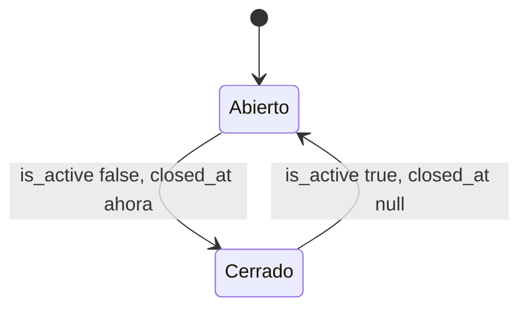

# Proyectos

Un **proyecto** agrupa las Solicitudes de Inversión, sus pagos, lotes y programación semanal. Se administra desde Filament (`/admin/projects`, grupo "Catálogos") y tiene un estado **ABIERTO / CERRADO** (`is_active`) que, al cerrarse, bloquea toda captura y deja el proyecto en modo solo lectura.

## Campos del modelo `Project`

| Campo | Tipo / cast | Uso |
|---|---|---|
| `name` | string único | Se guarda en MAYÚSCULAS y sin espacios extremos (`setNameAttribute`). |
| `branch_id` | FK `branches` | Sucursal del proyecto (obligatoria). |
| `currency_id` | FK `currencies` | "Moneda por Defecto"; el formulario propone MXN. La usa `ResolvesDisplayCurrency` como moneda de despliegue por defecto en el consolidado, PDFs y Excel. Ver [[Multimoneda]]. |
| `start_date`, `opening_date` | `date` | Fecha de inicio y de apertura; el consolidado calcula la duración entre ambas. |
| `authorized_budget` | `decimal:2` | Presupuesto autorizado; se muestra como referencia en el [[Consolidado por proyecto]]. |
| `is_active` | `boolean` | `true` = **abierto para captura**; `false` = **cerrado**. |
| `closed_at` | `datetime` | Fecha de cierre; se sincroniza automáticamente con `is_active`. |
| `requires_pm_approval` | `boolean` | Si está activo, las nuevas Solicitudes de Inversión del proyecto requieren aprobación del PM (`InvestmentApprovalService::createApprovals()`). Ver [[Flujo de solicitud de inversion]]. |
| `deleted_at` | SoftDeletes | Borrado lógico. |

Relaciones: `branch()`, `currency()`, `investmentRequests()` y `users()` (pivote `project_user`, ver [[Acceso por proyecto]]).

Scopes:

- `scopeActive()` → `is_active = true` (proyectos abiertos).
- `scopeAccessibleBy(User)` → proyectos accesibles para el usuario (ver [[Acceso por proyecto]]).

El modelo usa `LogsActivity` (registra los campos `fillable` modificados), así que el cierre y la reapertura quedan en el activity log con el usuario que hizo el cambio. Ver [[Auditoria y activity log]].

## Estado ABIERTO / CERRADO

### Sincronización de `closed_at`

`Project::booted()` registra un evento `saving`: si `is_active` cambió, pone `closed_at = now()` al cerrar y `closed_at = null` al reabrir. Aplica a cualquier vía de guardado (Filament, controllers, tinker).

Cerrar un proyecto **no** cambia el estado de solicitudes, pagos ni lotes: los congela. Al reabrir, todo continúa donde estaba.

### Quién puede cambiarlo

En `ProjectResource`, el toggle "Abierto para captura" del formulario y la `ToggleColumn` "Estado" de la tabla están deshabilitados salvo para `super_admin` y `project_manager`. El resto de campos del recurso se rige por los permisos Shield de `ProjectPolicy` (`view_any_project`, `update_project`, etc.). Ver [[Permisos Shield]].

### Bloqueo de captura (backend)

Todos los endpoints que crean o modifican información de un proyecto validan que esté abierto y responden **403** con el mensaje "Este proyecto está cerrado. No se pueden realizar capturas ni cambios." (o un error de validación equivalente):

| Endpoint | Guard |
|---|---|
| `InvestmentRequestController::store` | `abort_if` sobre el proyecto recibido. |
| `InvestmentRequestController::update` | Valida el proyecto actual **y** el proyecto destino si se intenta mover la solicitud. |
| `InvestmentPaymentRequestController::store` / `update` | `abort_if` sobre el proyecto del concepto. |
| `InvestmentPaymentBatchController::submit` / `destroyPayment` | `abort_if`. |
| `InvestmentPaymentDocumentController::upload` | `abort_if`. |
| `InvestmentPaymentReviewController::submit` | Si **cualquier** pago del envío pertenece a un proyecto cerrado, rechaza todo y lista los proyectos afectados (`errors['decisions']`). |
| `WeeklyPaymentScheduleController::store` | Igual, sobre los pagos incluidos (`errors['items']`). |
| `WeeklyPaymentReceiptController::store` | `abort_if`. |

Los formularios de captura (`InvestmentRequestController::create` / `edit`) solo listan `Project::active()->accessibleBy($user)`: un proyecto cerrado no aparece para nadie, ni siquiera PM o super_admin.

Los endpoints de lectura (index, show, consolidado, PDFs y Excel) no tienen este guard: un proyecto cerrado sigue consultable.

### Visibilidad de proyectos cerrados

| Pantalla | Usuario normal | PM / super_admin |
|---|---|---|
| [[Dashboards|Control Presupuestal]] (`InvestmentDashboardController`) | Oculto | Visible con banner |
| Hojas de Inversión – índice (`InvestmentSheetConsolidatedIndexController`) | Oculto | Visible con badge "Cerrado" |
| Revisión de pagos, Programación semanal | La lista sale de los proyectos con solicitudes visibles (no filtra `is_active`) | Visible con banner/badge |

> [!info] Rol CEO
> El filtro de proyectos cerrados en dashboard e índice del consolidado considera privilegiados solo a `super_admin` y `project_manager`; el CEO los ve ocultos aunque tenga acceso a todos los proyectos.

### UI de solo lectura

- `ProjectClosedBanner`: franja roja "Proyecto cerrado — Modo solo lectura. Ningún usuario puede capturar, modificar ni enviar registros. Cerrado el dd/mm/aaaa hh:mm." Se usa en consolidado (detalle), Control Presupuestal, revisión de pagos y programación semanal.
- `ProjectCombobox`: badge "Cerrado" en el trigger y en cada opción.
- `consolidated.tsx` (`isProjectClosed = !project.is_active`): deshabilita "Solicitar pago", eliminar draft, "Enviar lote", subir documentos, editar descripción, etc., con tooltip explicativo.

## `ProjectResource` (Filament)

- **Formulario**: Nombre del Proyecto (único), Sucursal, Moneda por Defecto, Fecha de Inicio, Fecha de Apertura, Presupuesto Autorizado, Abierto para captura, Requiere autorización del PM.
- **Tabla**: nombre, sucursal, moneda (toggleable), Estado (`ToggleColumn` con tooltip), Cerrado desde (oculta por defecto), Requiere PM, Creado.
- **Filtros**: Estado (Abiertos / Cerrados / Todos) y papelera (`TrashedFilter`).
- **Acciones**: editar, eliminar (soft delete) y restaurar, individuales y en lote.

> [!warning] Borrado de proyectos
> `DeleteAction` / `DeleteBulkAction` hacen soft delete. Por la regla del proyecto de nunca borrar registros, la vía operativa para "dar de baja" un proyecto es cerrarlo (`is_active = false`). Ver [[Proteccion de la base de datos]].

## Relacionado
- [[Project]] · [[Acceso por proyecto]] · [[Consolidado por proyecto]] · [[Dashboards]]
- [[Solicitudes de inversion]] · [[Solicitudes de pago de inversion]] · [[Lotes de pago]] · [[Programacion semanal]] · [[Comprobantes de pago]]
- [[Catalogos]] · [[Panel Filament]] · [[Auditoria y activity log]]
