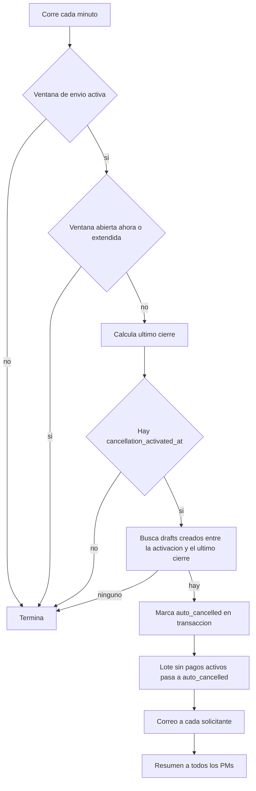

# Cancelación automática de borradores

Tercera fase de la [[Politica de ventanas de pago]]: cuando cierra la **ventana de envío** (submit), los pagos que siguen en `draft` se cancelan solos (`auto_cancelled`) y se libera su presupuesto. Dos horas antes del cierre se envía un recordatorio.

> [!info] Solo opera con la ventana de envío activa
> Ambos comandos terminan sin hacer nada si `submit_window_is_active` es falso (`PaymentRequestPolicyService::isSubmitWindowActive()`). La ventana se configura en `/admin/payment-policy-settings`.

## Programación (scheduler)

`routes/console.php`:

| Comando | Frecuencia | Opciones |
|---|---|---|
| `payment-drafts:cancel-expired` | Cada minuto | `withoutOverlapping()`, `runInBackground()`; acepta `--dry-run` |
| `payment-drafts:notify-closing-soon` | Cada 5 minutos | `withoutOverlapping()`, `runInBackground()` |

Ver [[Comandos y scheduler]].

## `cancellation_activated_at`

Al activar por primera vez la ventana de envío en Filament, `PaymentPolicySettings` guarda `cancellation_activated_at = now()` en la política. Solo los borradores **creados después** de esa marca son elegibles, para no cancelar retroactivamente borradores anteriores a la activación.

## `CancelExpiredPaymentDraftsCommand`

Detalle:

1. **Ventana abierta** (`isWithinSubmitWindow()`, que también es verdadero durante una extensión `submit_window_snoozed_until`): no cancela.
2. **Último cierre:** `getCurrentSubmitClosesAt($now)`; si cae en el futuro se resta una semana.
3. **Elegibles:** `status = draft`, `created_at >= cancellation_activated_at` y `created_at <= último cierre`. Incluye borradores de cualquier semana anterior, no solo de la última.
4. `--dry-run` lista folio, proveedor, solicitante y total sin modificar nada ni enviar correos.
5. En transacción: cada pago → `status = auto_cancelled` con fecha y motivo ("Ventana de envío cerró el … sin que el draft fuera enviado al CEO."). Cada lote afectado que ya no tenga pagos activos (todos rechazados o cancelados) y siga en `draft` → `auto_cancelled`.
6. Idempotente: en la siguiente ejecución ya no hay borradores elegibles.

`auto_cancelled` no está en `COMMITTED_STATUSES` ni en `PAID_STATUSES`, así que **libera presupuesto** ([[Presupuesto por concepto]]).

## Notificaciones

| Notificación | Destinatario | Canales | Contenido |
|---|---|---|---|
| `DraftPaymentsAutoCancelledNotification` | Cada solicitante con pagos cancelados (uno por persona) | correo + base de datos | "Tus N pagos no enviados fueron cancelados", lista de pagos y hora de cierre |
| `DraftPaymentsAutoCancelledPmSummaryNotification` | Todos los usuarios con rol `project_manager` | correo + base de datos | "Resumen de cancelaciones automáticas — {día}", agrupado por departamento con totales por moneda |
| `DraftPaymentsClosingSoonReminderNotification` | Cada usuario con borradores pendientes | correo + base de datos | "Tienes N pagos sin enviar — cierra en 2 horas", totales por moneda |

Todas implementan `ShouldQueue` (ver [[Colas y correo]]). Las notificaciones de base de datos aparecen en [[Notificaciones in-app]].

## `NotifyClosingSoonReminderCommand`

1. Requiere ventana de envío activa y **abierta** en este momento.
2. Calcula minutos al cierre; solo actúa entre **110 y 130 minutos** antes (la corrida cada 5 minutos cubre ese rango).
3. Idempotencia con caché: llave `closing_soon_reminder_sent:{cierre ISO8601}`.
4. Busca **todos** los pagos `draft` (cualquier proyecto/semana), agrupa por usuario y notifica.

> [!question] Por confirmar
> - `auto_cancelled_at` y `auto_cancellation_reason` existen en la migración `2026_06_11_230746_add_auto_cancelled_to_investment_payment_requests_table.php` pero **no están en `$fillable`** de `InvestmentPaymentRequest`; `update()` los descarta en silencio y solo se guarda el `status`. Verificar en BD si esas columnas quedan vacías.
> - El TTL de la llave de caché del recordatorio es `$closesAt->diffInSeconds($now) + 3600`. Con Carbon 3 (`nesbot/carbon` 3.x) `diffInSeconds()` es con signo y aquí resulta negativo (~ −7200 + 3600), lo que podría impedir que la llave se guarde y provocar recordatorios repetidos en cada corrida dentro del rango de 110–130 min. Confirmar con los registros de correo.
> - El recordatorio y la cancelación no filtran por proyecto cerrado.

## Relacionado
- [[Politica de ventanas de pago]] · [[Lotes de pago]] · [[Flujo de pago de inversion]] · [[Presupuesto por concepto]]
- [[Comandos y scheduler]] · [[Catalogo de correos]] · [[Notificaciones in-app]] · [[PaymentRequestPolicy (modelo)]]
