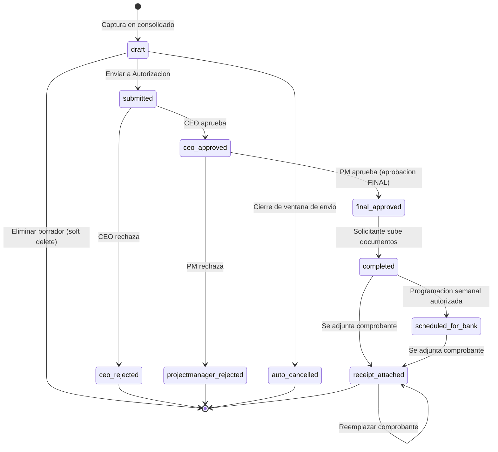

# Flujo de pago de inversión

Flujo vigente de un pago de inversión desde la captura hasta el comprobante bancario. Tiene **dos autorizaciones**: el CEO (primera ronda, por lote) y el PM (aprobación **FINAL**, por proyecto).

> [!warning] La aprobación final del CEO ya no existe
> El paso "CEO final" (`final_pending`, tokens `final_ceo_*`, sesiones `final_session_*`) se eliminó en julio de 2026. El PM deja los pagos directamente en `final_approved`. Los estados y columnas viejos solo aparecen en datos históricos.

## Diagrama de estados del pago

> [!info] Programación semanal hoy
> El botón "Guardar Programación" está deshabilitado por decisión operativa, así que en la práctica el camino es `completed → receipt_attached`. Ver [[Programacion semanal]].

## Paso a paso

| # | Paso | Quién | Dónde | Estado del pago | Estado del lote | Correo |
|---|---|---|---|---|---|---|
| 1 | Capturar pago (ventana de captura abierta) | Usuario del departamento | [[Consolidado por proyecto]] → modal "Solicitar Pago" | `draft` | `draft` (se crea si no existe) | — |
| 2 | Editar / eliminar borrador | Dueño del pago | Tarjeta "Pagos en Borrador" | `draft` / soft delete | `draft` | — |
| 3 | Enviar a autorización (ventana de envío abierta) | Creador del lote o miembro del departamento | Botón "Enviar a Autorización" | `submitted`; los no seleccionados pasan a un lote draft nuevo | `submitted` + token CEO 96 h | A todos los `ceo`: "Lote pendiente — {proyecto} · {departamento}" con enlace público |
| 4 | Aprobar / rechazar pago por pago | CEO | Página pública `/investment-batch-approval/{token}` | `ceo_approved` o `ceo_rejected` | `ceo_approved` o `ceo_rejected` | A cada solicitante: resumen (contexto `ceo`); si hubo aprobados, a todos los `project_manager`: cola de revisión del proyecto |
| 5 | Aprobación FINAL (puede reducir monto) | PM | `/investment-payment-review` | `final_approved` (+ `approved_amount`) o `projectmanager_rejected` | `final_approved` o `projectmanager_rejected` cuando ya no quedan pendientes | A cada solicitante: resumen (contexto `final`); a todos los `project_manager`: resumen con PDF adjunto por proyecto |
| 6 | Subir documentos (puede cambiar el tipo) | Solicitante o super_admin | Consolidado → "Pagos Pendientes de Documentos" | `completed` | — | — |
| 7 | Programación semanal (hoy deshabilitada en UI) | Usuario con visibilidad del proyecto; autoriza el usuario de `INVESTMENT_AUTHORIZER_EMAIL` | `/weekly-payment-schedule` + enlace `/approval/{token}` | `scheduled_for_bank` (solo incluidos, al autorizar) | — | Al autorizador: "Programación de Pagos Semanal" (token 48 h) |
| 8 | Adjuntar comprobante | Usuario con visibilidad del proyecto | `/weekly-payment-schedule` → "Comprobante" | `receipt_attached` (fin) | — | — |

Detalle de cada paso: [[Solicitudes de pago de inversion]], [[Lotes de pago]], [[Aprobacion del CEO]], [[Revision del PM]], [[Documentos de pago]], [[Programacion semanal]], [[Comprobantes de pago]].

## Bloqueos transversales

- **Proyecto cerrado** (`projects.is_active = false`): 403 en captura, edición, eliminación, envío, revisión del PM, documentos, programación y comprobante. Ver [[Proyectos]].
- **Ventanas de pago:** captura/edición y envío dependen de [[Politica de ventanas de pago]]; los usuarios con rol de override (por defecto `super_admin`) las ignoran. Los intentos bloqueados se auditan.
- **Presupuesto:** al capturar y editar, el total en MXN no puede exceder el disponible del concepto. Ver [[Presupuesto por concepto]].

## Efecto en presupuesto por estado

| Grupo | Estados |
|---|---|
| Comprometido | `draft`, `submitted`, `ceo_approved`, `projectmanager_review`, `projectmanager_approved`, `final_approved`, `documents_pending` |
| Pagado | `pending_approval`, `approved`, `completed`, `scheduled_for_bank`, `receipt_attached` |
| Libera (no cuenta) | `ceo_rejected`, `projectmanager_rejected`, `auto_cancelled`, `rejected`, `final_rejected`, borrados |

## Estados históricos

| Estado | Origen |
|---|---|
| `projectmanager_review`, `projectmanager_approved`, `final_pending`, `final_rejected`, `documents_pending` | Versiones anteriores del flujo; `projectmanager_review` todavía se acepta como entrada en la revisión del PM |
| `pending_approval`, `approved`, `rejected` | Flujo legacy de aprobación por correo por pago (`InvestmentPaymentApprovalService`), ya no se invoca al capturar; los pagos `approved` sin lote siguen visibles para super_admin y en la programación |

## Relacionado
- [[Solicitudes de pago de inversion]] · [[Lotes de pago]] · [[Aprobacion del CEO]] · [[Revision del PM]]
- [[Documentos de pago]] · [[Programacion semanal]] · [[Comprobantes de pago]] · [[Cancelacion automatica de borradores]]
- [[Presupuesto por concepto]] · [[Politica de ventanas de pago]] · [[Estados]] · [[Catalogo de correos]] · [[Roles y actores]]
