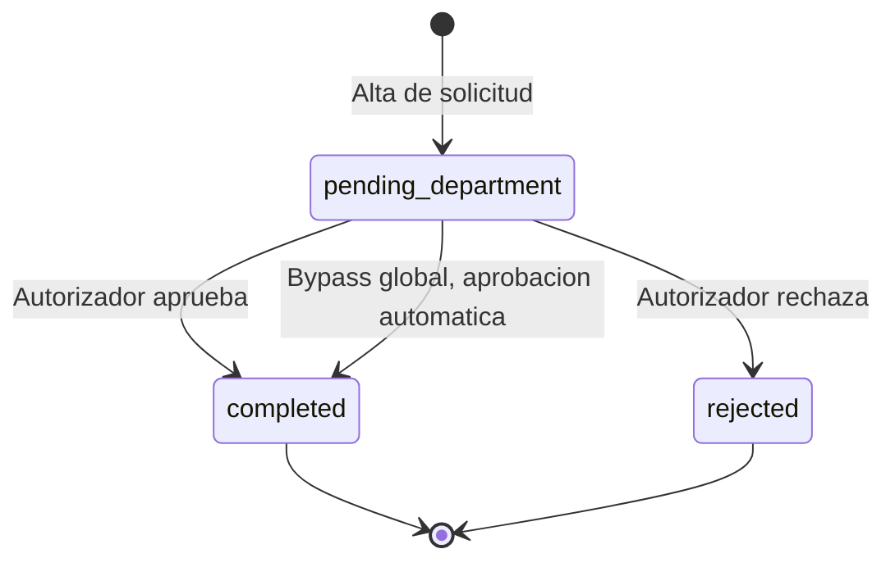

# Flujo de solicitud de inversión

Ciclo de vida de una [[Solicitudes de inversion|solicitud de inversión]]: una sola autorización que la deja `completed` (presupuesto disponible para pagos) o `rejected`.

## Estados (spatie/laravel-model-states)

Clase base `App\States\InvestmentRequest\InvestmentRequestState`:

```php
#[
    DefaultState(PendingDepartment::class),
    AllowTransition(PendingDepartment::class, Completed::class),
    AllowTransition(PendingDepartment::class, Rejected::class),
]
```

| Clase | `$name` (valor en BD) | Etiqueta | Color | ¿Se usa? |
|---|---|---|---|---|
| `PendingDepartment` | `pending_department` | Pendiente Departamento | warning | Sí, estado inicial |
| `Completed` | `completed` | Finalizado | success | Sí |
| `Rejected` | `rejected` | Rechazado | danger | Sí |
| `PendingAdministration` | `pending_administration` | Pendiente Administración | info | No: no hay transición permitida hacia él |
| `PendingTreasury` | `pending_treasury` | Pendiente Tesorería | purple | No: no hay transición permitida hacia él |

> [!info] Herencia del flujo legacy
> `PendingAdministration` y `PendingTreasury` replican la cadena del [[Flujo legacy de solicitud de pago]], pero en inversión solo se usa una etapa (`stage = department`, `level = 1`).

## Diagrama



## Quién autoriza

`InvestmentApprovalService::createApprovals()` al crear la solicitud:

| Prioridad | Condición | Autorizador | Notificación |
|---|---|---|---|
| 1 | Proyecto con `requires_pm_approval = true` | Aprobación a nombre del primer `project_manager`; se notifica a **todos** los PMs (si no hay PMs, cae al punto 3) | `InvestmentRequestCreated` con token |
| 2 | `INVESTMENT_REQUEST_REQUIRE_AUTHORIZATION = false` | Nadie: aprobación automática registrada a nombre del solicitante, transición inmediata a `completed` | — |
| 3 | Por defecto | Usuario cuyo correo es `INVESTMENT_AUTHORIZER_EMAIL` (si no existe, no se crea aprobación) | `InvestmentRequestCreated` con token |

Las aprobaciones (`InvestmentRequestApproval`) llevan `approval_token` UUID con vigencia de **48 horas**.

> [!warning] Proyecto con candado y un solo dueño
> En el modo por proyecto la aprobación se registra a nombre del **primer** PM; `approve()` y `reject()` buscan una aprobación pendiente del usuario que actúa, por lo que otro PM notificado no puede aprobar desde el portal, solo con el enlace del correo (el token resuelve la aprobación y actúa como su dueño).

## Canales para aprobar o rechazar

| Canal | Ruta / lugar | Requisito |
|---|---|---|
| Portal (Inertia) | `POST investment-sheets/{uuid}/approve` y `/reject` (throttle 10/min) | Aprobación pendiente a nombre del usuario; rechazo con comentarios (`RejectInvestmentRequestRequest`) |
| Correo | `/approval/{token}`, `/approval/{token}/approve`, `/approval/{token}/reject` (`EmailApprovalController`) | Token vigente y aprobación pendiente; el rechazo exige comentario de mín. 10 caracteres |
| Filament | Acciones "Aprobar" / "Rechazar" en `InvestmentRequestResource` | Aprobación pendiente del usuario |

## Efectos

- **Aprobar** (`InvestmentApprovalService::approve()`): solo si está en `pending_department`; marca la aprobación `approved`, invalida el token, transiciona a `completed` y notifica al solicitante (`InvestmentRequestCompleted`). La solicitud empieza a sumar al presupuesto del concepto ([[Presupuesto por concepto]]).
- **Rechazar** (`reject()`): marca `rejected` con comentarios, transiciona a `rejected` y notifica al solicitante (`InvestmentRequestRejected`).
- Solo en `pending_department` se puede editar completa la solicitud; la micro-edición de concepto/descripción funciona en cualquier estado.

## Notificaciones no usadas por este flujo

`InvestmentRequestApproved` e `InvestmentRequestLevel2Rejected` existen en `app/Notifications/` pero el servicio actual no las envía (no hay nivel 2 en inversión).

## Relacionado
- [[Solicitudes de inversion]] · [[Presupuesto por concepto]] · [[Flujo de pago de inversion]]
- [[Estados]] · [[InvestmentRequest]] · [[InvestmentRequestApproval]] · [[Catalogo de correos]] · [[Roles y actores]]
