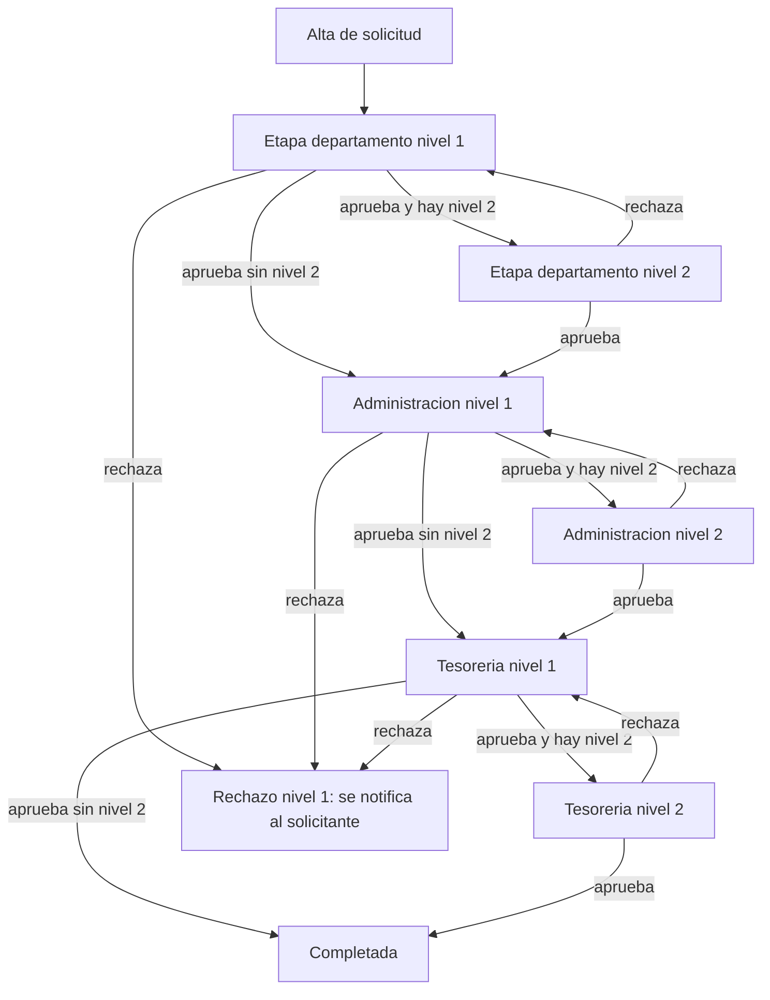

# Flujo legacy de solicitud de pago

Flujo de autorización de las solicitudes de pago generales (`PaymentRequest`, ruta `payment-requests`), anterior al módulo de inversión. Recorre tres etapas (departamento → Administración → Tesorería), cada una con hasta dos niveles de autorizador. Ver [[Modulo legacy Payment Requests]].

## Estados

`App\States\PaymentRequest\PaymentRequestState`:

```php
#[
    DefaultState(PendingDepartment::class),
    AllowTransition(PendingDepartment::class, PendingAdministration::class),
    AllowTransition(PendingAdministration::class, PendingTreasury::class),
    AllowTransition(PendingTreasury::class, Completed::class),
]
```

| Clase | `$name` | Etiqueta | Color |
|---|---|---|---|
| `PendingDepartment` | `pending_department` | Pendiente Departamento | warning |
| `PendingAdministration` | `pending_administration` | Pendiente Administración | info |
| `PendingTreasury` | `pending_treasury` | Pendiente Tesorería | purple |
| `Completed` | `completed` | Finalizado | success |

> [!warning] No existe estado "rechazado"
> No hay clase `Rejected` ni transición de rechazo: un rechazo no cambia el estado de la solicitud. El enum `App\Enums\PaymentRequestStatus` (`pending`, `approved`, `rejected`, `paid`) no es el que usa el cast `status` del modelo.

## Pipeline (`ApprovalService::PIPELINE`)

| Etapa (`stage`) | Estado | Siguiente estado | Departamento que autoriza |
|---|---|---|---|
| `department` | `pending_department` | `pending_administration` | El departamento de la solicitud |
| `administration` | `pending_administration` | `pending_treasury` | Departamento llamado `ADMINISTRACIÓN` |
| `treasury` | `pending_treasury` | `completed` | Departamento llamado `TESORERÍA` |

Cada departamento define `authorizer_level_1_id` y opcionalmente `authorizer_level_2_id` (relaciones `authorizerLevel1` / `authorizerLevel2`). Ver [[Department]].

## Diagrama



## Reglas de `ApprovalService`

- **`createApprovals()`** (llamado en `PaymentRequestController::store()`): crea la aprobación `department` nivel 1 para el autorizador nivel 1 del departamento, con token de **48 h**, y le envía `PaymentRequestCreated`. Si el departamento no tiene autorizador, no se crea nada.
- **`approve()`**:
  1. Marca la aprobación pendiente del usuario en la etapa actual como `approved` e invalida su token.
  2. Si recibe `number_purchase_invoices` / `number_vendor_payments` (folios SAP), los guarda.
  3. Si era nivel 1 y el departamento de la etapa tiene nivel 2 → crea aprobación nivel 2 y notifica `PaymentRequestApproved` al nivel 2.
  4. Si no → transiciona al siguiente estado. Si llegó a `completed`, notifica `PaymentRequestCompleted` al solicitante; si no, crea la aprobación nivel 1 de la siguiente etapa y notifica `PaymentRequestApproved`.
- **`reject()`**:
  - Nivel 1: marca `rejected` con comentarios y notifica `PaymentRequestRejected` al solicitante. El estado no cambia y no queda ninguna aprobación pendiente.
  - Nivel 2: crea una **nueva** aprobación nivel 1 pendiente (token nuevo), notifica `PaymentRequestLevel2Rejected` al nivel 1 y `PaymentRequestRejected` al solicitante.

> [!question] Por confirmar
> Tras un rechazo de nivel 1 la solicitud queda en su estado `pending_*` sin aprobaciones pendientes y no hay forma en el código de reanudarla. ¿Es el comportamiento esperado (solicitud "muerta") o falta un estado de rechazo?

## Canales de aprobación

| Canal | Ruta | Notas |
|---|---|---|
| Portal | `POST payment-requests/{id}/approve` y `/reject` (throttle 10/min) | `PaymentRequestApprovalController`; el aprobador puede enviar folios SAP |
| Folios SAP posteriores | `PATCH payment-requests/{id}/sap-folios` | Solo quien aprobó la etapa `administration` (facturas de compra) o `treasury` (pagos a proveedor) |
| Correo | `/approval/{token}` (+ `/approve`, `/reject`), throttle 10/min, sin login | `EmailApprovalController` |

## `EmailApprovalController` (compartido)

Controlador público que resuelve el token buscando en este orden: `PaymentRequestApproval`, `InvestmentRequestApproval`, `InvestmentPaymentApproval`, `WeeklyPaymentScheduleApproval`. Reglas comunes:

- Token inexistente → "El enlace de autorización no es válido o ya fue utilizado."
- Token expirado (`isTokenExpired()`) → mensaje para entrar al portal.
- Aprobación ya respondida → "Esta solicitud ya fue autorizada/rechazada previamente."
- Rechazo: comentario obligatorio de al menos 10 caracteres.
- Delega en `ApprovalService`, `InvestmentApprovalService`, `InvestmentPaymentApprovalService` o `WeeklyPaymentScheduleApprovalService` según el tipo; vistas Blade `approval.show`, `approval.show-schedule`, `approval.result`.

## Relacionado
- [[Modulo legacy Payment Requests]] · [[Flujo de solicitud de inversion]] · [[Programacion semanal]]
- [[PaymentRequest]] · [[PaymentRequestApproval]] · [[Department]] · [[Estados]]
- [[SAP Business One]] · [[Catalogo de correos]] · [[Middleware y rutas protegidas]]
