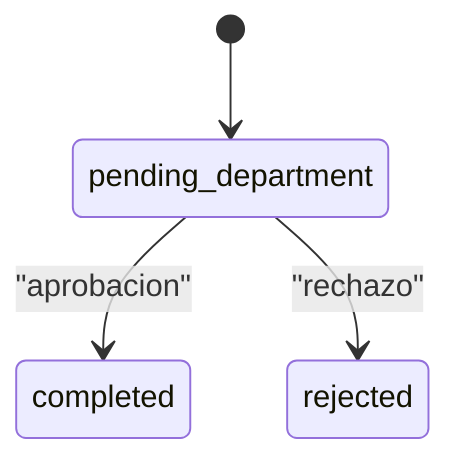
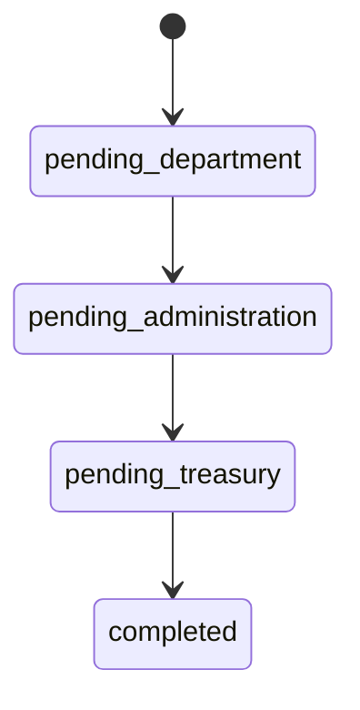
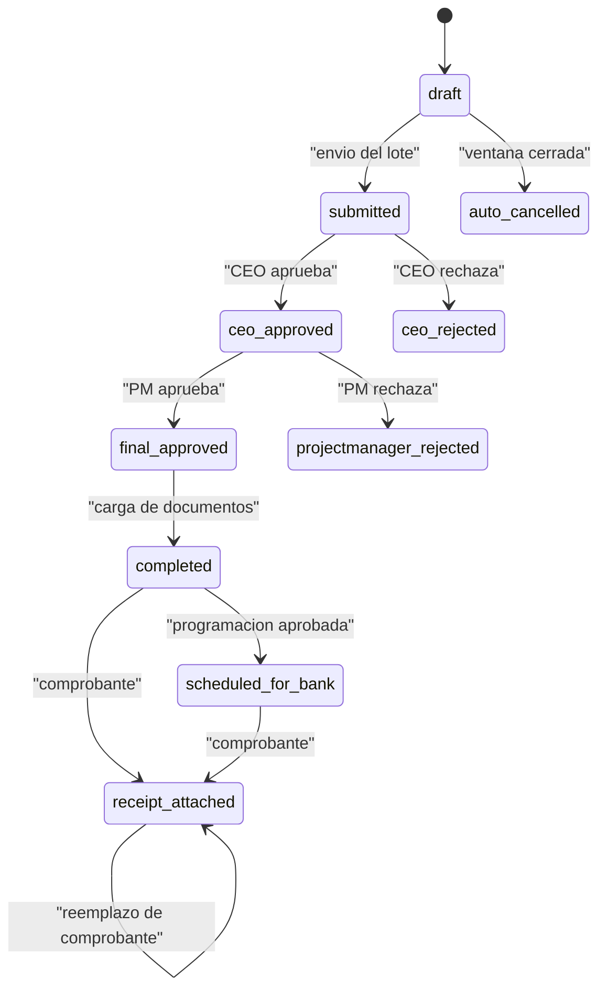

# Estados

Catálogo de todos los estados del sistema: los dos modelos con máquina de estados (spatie/laravel-model-states) y los estados en texto de pagos de inversión, lotes y programación semanal.

## 1. Estados spatie (`app/States`)

Ambas clases base usan atributos PHP `#[DefaultState]` y `#[AllowTransition]`. Cada estado define `label()` y `color()` (colores Filament).

### InvestmentRequest (`InvestmentRequestState`)

| Valor en BD | Clase | Etiqueta | Color |
|---|---|---|---|
| `pending_department` | `PendingDepartment` (default) | Pendiente Departamento | warning |
| `completed` | `Completed` | Finalizado | success |
| `rejected` | `Rejected` | Rechazado | danger |
| `pending_administration` | `PendingAdministration` | Pendiente Administración | info |
| `pending_treasury` | `PendingTreasury` | Pendiente Tesorería | purple |

- Transiciones permitidas: solo `PendingDepartment → Completed` y `PendingDepartment → Rejected`.
- `PendingAdministration` y `PendingTreasury` existen como clases pero **no tienen transiciones** hacia ellas (sin uso en el flujo actual).
- Quién transiciona: `InvestmentApprovalService` (`approve`, `reject`, `autoApprove`).
- Solo las solicitudes `completed` cuentan como presupuesto (`whereState('status', Completed::class)`).

### PaymentRequest legacy (`PaymentRequestState`)

| Valor en BD | Clase | Etiqueta | Color |
|---|---|---|---|
| `pending_department` | `PendingDepartment` (default) | Pendiente Departamento | warning |
| `pending_administration` | `PendingAdministration` | Pendiente Administración | info |
| `pending_treasury` | `PendingTreasury` | Pendiente Tesorería | purple |
| `completed` | `Completed` | Finalizado | success |

- No hay estado de rechazo: un rechazo marca la aprobación como `rejected` y la solicitud se queda en su etapa. Ver [[Flujo legacy de solicitud de pago]].

> [!warning] Cambio directo desde Filament
> `EditInvestmentRequest` y `EditPaymentRequest` asignan `$record->status = $data['status']` sin pasar por `transitionTo()`. El campo solo está habilitado para `super_admin`, que puede así poner cualquier estado saltándose las transiciones permitidas.

## 2. Pagos de inversión (`investment_payment_requests.status`)

Columna string, sin máquina de estados. Etiquetas tomadas de `InvestmentPaymentRequestResource::statusLabel()`.

| Estado | Etiqueta | Quién lo asigna | Grupo |
|---|---|---|---|
| `draft` | Borrador | `InvestmentPaymentRequestController::store()` | Comprometido |
| `submitted` | Enviado | `InvestmentPaymentBatchController::submit()` | Comprometido |
| `ceo_approved` | CEO Aprobó | `InvestmentBatchApprovalController::review()` | Comprometido |
| `ceo_rejected` | CEO Rechazó | `InvestmentBatchApprovalController::review()` | Libera |
| `projectmanager_review` | En revisión PM | Solo se lee (histórico) | Comprometido |
| `projectmanager_approved` | PM Aprobó (histórico) | Migración `2026_07_14` lo convirtió en `final_approved` | Comprometido |
| `projectmanager_rejected` | PM Rechazó | `InvestmentPaymentReviewController::submit()` | Libera |
| `final_approved` | Aprobado Final | `InvestmentPaymentReviewController::submit()` (el PM es el paso terminal) | Comprometido |
| `documents_pending` | Esperando docs | Solo se lee (histórico) | Comprometido |
| `completed` | Completado | `InvestmentPaymentDocumentController::upload()` | Pagado |
| `scheduled_for_bank` | Programado en banco | `WeeklyPaymentScheduleApprovalService::approve()` | Pagado |
| `receipt_attached` | Comprobante adjunto | `WeeklyPaymentReceiptController::store()` | Pagado (fin) |
| `auto_cancelled` | (sin etiqueta propia) | `CancelExpiredPaymentDraftsCommand` | Libera |
| `approved` | Aprobado (Legacy) | `InvestmentPaymentApprovalService::approve()` | Pagado |
| `pending_approval` | Pendiente (Legacy) | Default original de la columna | Pagado |
| `rejected` | Rechazado (Legacy) | `InvestmentPaymentApprovalService::reject()` | Libera |
| `final_pending`, `final_rejected` | Históricos | Ya no se asignan | — |

Notas de transición verificadas en código:
- La carga de documentos acepta `final_approved`; `super_admin` también puede cargar sobre `approved` y `completed`.
- El comprobante se acepta desde `approved`, `completed`, `scheduled_for_bank` y `receipt_attached` (`UPLOADABLE_STATUSES`); no exige que exista programación aprobada.
- La programación semanal lista pagos `approved`, `completed` y `receipt_attached` con `payment_provision_date`.
- El PM revisa pagos en `ceo_approved` o `projectmanager_review` y puede fijar `approved_amount ≤ total`.

### COMMITTED_STATUSES y PAID_STATUSES

Definidas en `app/Models/InvestmentPaymentRequest.php`:

| Constante | Estados | Significado |
|---|---|---|
| `COMMITTED_STATUSES` | `draft`, `submitted`, `ceo_approved`, `projectmanager_review`, `projectmanager_approved`, `final_approved`, `documents_pending` | Reserva presupuesto desde el borrador, aún no pagado |
| `PAID_STATUSES` | `pending_approval`, `approved`, `completed`, `scheduled_for_bank`, `receipt_attached` | Pago efectivo (flujo nuevo desde documentos + legacy) |

Ambas restan del presupuesto: `disponible = presupuesto − comprometido − pagado` (`InvestmentRequest::budgetBreakdown()`). Los rechazados y `auto_cancelled` no aparecen en ninguna lista y por tanto liberan el saldo. Ver [[Presupuesto por concepto]].

> [!info] Agrupaciones de reportes
> `InvestmentPaymentHistoryPdfController` e `InvestmentPaymentHistoryExcelController` usan su propio grupo `in_process` (`submitted`, `ceo_approved`, `projectmanager_review`, `projectmanager_approved`, `final_pending`, `documents_pending`, `pending_approval`) y `rejected`; `resources/js/pages/investment-sheets/consolidated.tsx` usa la misma lista sin `final_pending`. Nótese que ahí `pending_approval` cuenta como "en proceso", mientras que en `PAID_STATUSES` cuenta como pagado.

## 3. Lotes (`investment_payment_batches.status`)

| Estado | Etiqueta | Asignado por |
|---|---|---|
| `draft` | Borrador | Creación del lote / pagos no seleccionados al enviar |
| `submitted` | Enviado a CEO | `InvestmentPaymentBatchController::submit()` |
| `ceo_approved` | CEO Aprobó | Al menos un pago aprobado por CEO |
| `ceo_rejected` | CEO Rechazó | Ningún pago aprobado |
| `final_approved` | Aprobado Final | PM terminó y aprobó al menos uno |
| `projectmanager_rejected` | PM Rechazó | PM rechazó todos |
| `auto_cancelled` | — | Comando de cancelación (solo si el lote seguía en `draft`) |
| `projectmanager_review`, `projectmanager_approved`, `final_pending`, `final_rejected` | Históricos | `final_pending` se migró a `final_approved` (`2026_07_14`) |

## 4. Programación semanal y aprobaciones

| Entidad | Estados |
|---|---|
| `weekly_payment_schedules.status` | `draft` (default de columna), `pending_approval` (al crear), `approved`, `rejected` |
| `*_approvals.status` (todas las tablas de aprobación) | `pending`, `approved`, `rejected` |

## Relacionado
- [[InvestmentPaymentRequest]] · [[InvestmentPaymentBatch]] · [[InvestmentRequest]] · [[PaymentRequest]] · [[WeeklyPaymentSchedule]]
- [[Flujo de pago de inversion]] · [[Flujo de solicitud de inversion]] · [[Enums]]
