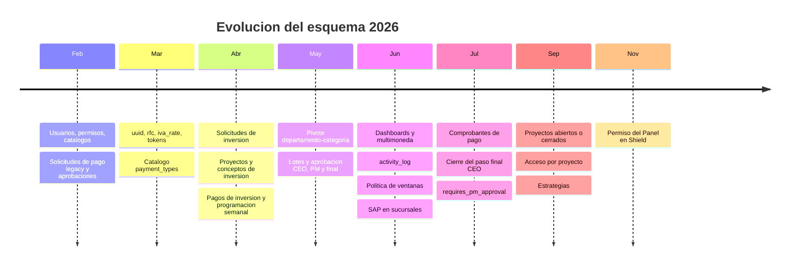

# Migraciones

Historia del esquema en `database/migrations` (98 archivos), agrupada por bloque funcional y fecha. Indica qué tablas y columnas introdujo cada bloque y qué migraciones también transforman datos.

> [!danger] Regla del proyecto
> Nunca ejecutar `migrate:fresh`, `migrate:refresh`, `db:wipe` ni rollbacks destructivos. `AppServiceProvider` activa `DB::prohibitDestructiveCommands()` en producción. Ver [[Proteccion de la base de datos]].

## Línea de tiempo

## Bloques

### 0. Base de Laravel y Fortify (`0001_01_01_*`, `2025_08_14`)

| Migración | Introduce |
|---|---|
| `0001_01_01_000000_create_users_table` | `users`, `password_reset_tokens`, `sessions` |
| `0001_01_01_000001_create_cache_table` | `cache`, `cache_locks` |
| `0001_01_01_000002_create_jobs_table` | `jobs`, `job_batches`, `failed_jobs` |
| `2025_08_14_170933_add_two_factor_columns_to_users_table` | `two_factor_secret`, `two_factor_recovery_codes`, `two_factor_confirmed_at` |

### 1. Usuarios, permisos y catálogos (2026-02-11 a 02-13)

| Migración | Introduce |
|---|---|
| `2026_02_11_174837_create_permission_tables` | `permissions`, `roles`, `model_has_permissions`, `model_has_roles`, `role_has_permissions` (spatie) |
| `2026_02_11_223146_add_is_active_and_soft_deletes_to_users_table` | `users.is_active`, `users.deleted_at` |
| `2026_02_11_231556_create_currencies_table` | `currencies` (`name` único, `prefix`) |
| `2026_02_11_235649_create_societies_table` | `societies` |
| `2026_02_11_235824_create_branches_table` | `branches` (`society_id`) |
| `2026_02_12_003308_create_expense_concepts_table` | `expense_concepts` |
| `2026_02_13_100001/2/3` | `positions`, `departments`, pivote `department_user` |
| `2026_02_13_200001`, `2026_02_13_234520` | `users.department_id`, `users.position_id` |

### 2. Solicitudes de pago legacy (2026-02-12 a 03-15)

| Migración | Introduce | Datos |
|---|---|---|
| `2026_02_12_230209_create_payment_requests_table` | `payment_requests` (proveedor, folio factura, catálogos, montos, `status` default `pending`) | |
| `2026_02_13_000001_add_payment_type_to_payment_requests_table` | `payment_type` string, `advance_documents` json | |
| `2026_02_16_181055` / `181102` / `181342` | `payment_requests.department_id`, `payment_request_approvals`, `notifications` | |
| `2026_02_16_185556_update_existing_payment_request_statuses` | — | `pending` → `pending_approval` |
| `2026_02_19_192511_add_folio_number_to_payment_requests_table` | `folio_number` único | Numera los existentes por `id` |
| `2026_02_19_192633_add_stage_to_payment_request_approvals_table` | `stage` | |
| `2026_02_19_192634_migrate_payment_request_statuses_to_sequential_flow` | — | Convierte estados al flujo secuencial (`pending_department`, `completed`) |
| `2026_03_04_030125` | `number_purchase_invoices`, `number_vendor_payments` (folios SAP) | |
| `2026_03_04_082744_add_uuid_to_payment_requests_table` | `uuid` único | Rellena uuid a existentes |
| `2026_03_09_000000`, `2026_03_09_100000` | `rfc`, `iva_rate` (default `0.16`) | |
| `2026_03_10_162115_rename_full_to_invoice_in_payment_requests` | — | `full` → `invoice` |
| `2026_03_14_012853` | `approval_token`, `approval_token_expires_at` en aprobaciones | |
| `2026_03_15_003655/56/57` | `imports`, `exports`, `failed_import_rows` (Filament), `expense_concepts.is_active` | |
| `2026_03_15_032138_create_payment_types_table` | `payment_types` | |
| `2026_03_15_032152_convert_payment_type_to_foreign_key_in_payment_requests` | `payment_type_id` FK; elimina `payment_type` string | Crea tipos `invoice`, `advance`, `investment` y mapea |
| `2026_04_09_182810_add_authorizer_levels_to_departments_and_approvals` | `departments.authorizer_level_1_id/2_id`, `payment_request_approvals.level` | Toma los dos primeros usuarios de `department_user` como autorizadores; quita el índice único |

### 3. Solicitudes de inversión y catálogos de inversión (2026-04-10 a 05-07)

| Migración | Introduce |
|---|---|
| `2026_04_10_000001_create_investment_requests_table` | `investment_requests` (estado default `pending_department`) |
| `2026_04_10_000002_create_investment_request_approvals_table` | `investment_request_approvals` (con token) |
| `2026_04_10_200000`, `2026_04_10_210000` | `payment_types.category`; `invoice_documents_mode` y `additional_documents_mode` reemplazan `requires_invoice_documents` |
| `2026_04_15_133051/133102/133106` | `projects`, `investment_expense_categories`, `investment_expense_concepts` |
| `2026_04_15_142300`, `160043`, `172925` | `investment_requests.project_id`, `investment_expense_concept_id`, contacto del proveedor |
| `2026_04_15_154128` | `invoice_folio` nullable |
| `2026_04_15_201156` | `is_addendum` |
| `2026_04_15_202516`, `2026_04_15_202946`, `2026_04_28_165057` | Recreación de `investment_requests` (y FKs de tablas hijas) para volver nullable `expense_concept_id` y `provider` |
| `2026_04_28_194416` | `investment_expense_categories.super_category` |
| `2026_05_07_183449/183504/183558` | Pivote `department_investment_expense_category`, backfill y eliminación de `investment_expense_categories.department_id` (aborta si el conteo no cuadra) |
| `2026_05_07_203317` | Único compuesto `name + super_category` |

> [!warning] SQL específico de SQLite
> `2026_04_15_202516`, `2026_04_15_202946` y `2026_04_28_165057` usan `PRAGMA foreign_keys`, `sqlite_master` y `ALTER TABLE ... RENAME` sin validar el driver. No son ejecutables tal cual en PostgreSQL.
>
> > [!question] Por confirmar
> > Documentar cómo se construyó el esquema PostgreSQL de producción (¿migración de datos desde SQLite o migraciones ejecutadas con ajustes?). Ver [[Produccion]].

### 4. Pagos de inversión y programación semanal (2026-04-15 a 04-16)

| Migración | Introduce |
|---|---|
| `2026_04_15_182435_create_investment_payment_requests_table` | `investment_payment_requests` (status default `pending_approval`) |
| `2026_04_15_182521_create_investment_payment_approvals_table` | `investment_payment_approvals` |
| `2026_04_15_185122` | Reemplaza `payment_type_id` por `payment_type` string(20) default `anticipo` |
| `2026_04_15_192935` | `expense_concept_id` nullable |
| `2026_04_16_154125` | `payment_provision_date`, `payment_week_number` |
| `2026_04_16_160908/09/10` | `weekly_payment_schedules` (único semana+año), `weekly_payment_schedule_items`, `weekly_payment_schedule_approvals` |

### 5. Lotes y aprobación por etapas (2026-05-17 a 05-28)

| Migración | Introduce |
|---|---|
| `2026_05_17_155651_create_investment_payment_batches_table` | `investment_payment_batches` |
| `2026_05_17_155652` | `investment_payment_requests.batch_id` |
| `2026_05_17_162818`, `162819` | Token CEO en lotes; `ceo_rejection_reason`, `ceo_reviewed_at` en pagos |
| `2026_05_17_171438` | `approved_amount`, `pm_rejection_reason`, `pm_reviewed_at` |
| `2026_05_17_173713`, `173714` | Token de aprobación final en lotes; `final_rejection_reason`, `final_reviewed_at` en pagos |
| `2026_05_28_195207` | `final_session_token` en lotes |

### 6. Dashboards, multimoneda, auditoría y política (2026-06-04 a 06-22)

| Migración | Introduce | Datos |
|---|---|---|
| `2026_06_04_165911` | `projects.start_date`, `opening_date`, `authorized_budget` | |
| `2026_06_04_170012` | `investment_requests.is_deductive` | |
| `2026_06_08_193000` | `currencies.exchange_rate` (idempotente) | |
| `2026_06_08_194724` | `projects.currency_id` obligatoria | Rellena con la moneda `MXN` |
| `2026_06_08_231006/07/08` | `activity_log` + `event` + `batch_uuid` | |
| `2026_06_11_230723` | `payment_request_policies` | |
| `2026_06_11_230746` | `auto_cancelled_at`, `auto_cancellation_reason` | |
| `2026_06_11_230816` | `payment_capture_attempt_logs` | |
| `2026_06_22_003800` | — | Copia `users.department_id` a la pivote `department_user` |
| `2026_06_22_101052` | `branches.sap_database`, `sap_branch_id`, `sap_user`, `sap_password`, `is_active` | |
| `2026_06_22_215829` | `investment_expense_concepts.sap_item_code` único | |

### 7. Comprobantes y simplificación del flujo (2026-07)

| Migración | Introduce | Datos |
|---|---|---|
| `2026_07_02_131715` | `payment_receipt_documents`, `receipt_uploaded_at`, `receipt_uploaded_by` | |
| `2026_07_09_174738` | `societies.rfc`, `constancia_situacion_fiscal` | |
| `2026_07_14_130637_finalize_pending_ceo_approval_batches` | — | Lotes `final_pending` → `final_approved` (limpia tokens); pagos `projectmanager_approved` → `final_approved`. Retira el paso de aprobación final del CEO |
| `2026_07_20_154721` | `branches.cost_center` | |
| `2026_07_21_191754` | `projects.requires_pm_approval` | |

### 8. Proyectos cerrados, acceso por proyecto y estrategias (2026-09)

| Migración | Introduce | Datos |
|---|---|---|
| `2026_09_10_175139` | `projects.closed_at` | |
| `2026_09_10_191942` | Pivote `project_user` | |
| `2026_09_10_192000_backfill_project_user_from_departments` | — | Asigna a usuarios no privilegiados los proyectos donde sus departamentos ya capturaron solicitudes (idempotente) |
| `2026_09_22_135543` | `strategies` | |
| `2026_09_22_135544` | `strategy_id`, `strategy_amount`, `strategy_factor_snapshot`, `strategy_name_snapshot` en pagos | |

### Permisos del portal (2026-11-02)

| Migración | Introduce |
|---|---|
| `2026_11_02_192516_add_portal_dashboard_permission` | Solo datos: crea `view_portal::dashboard` con `firstOrCreate`, lo asigna a `super_admin`, `admin_sp`, `administrador`, `project_manager` y `ceo`, y limpia la caché de permisos. `down()` vacío. Ver [[ADR-024 Panel y Solicitudes de Pago controlados desde Shield]] |

## Cómo agregar una migración

- `php artisan make:migration ... --no-interaction`.
- Al modificar una columna, repetir todos sus atributos previos.
- Las migraciones de datos deben ser idempotentes (`updateOrInsert`, `syncWithoutDetaching`, `insertOrIgnore`) y nunca borrar registros.

## Relacionado
- [[Modelo de datos]] · [[Estados]] · [[Proteccion de la base de datos]] · [[Deploy]]
