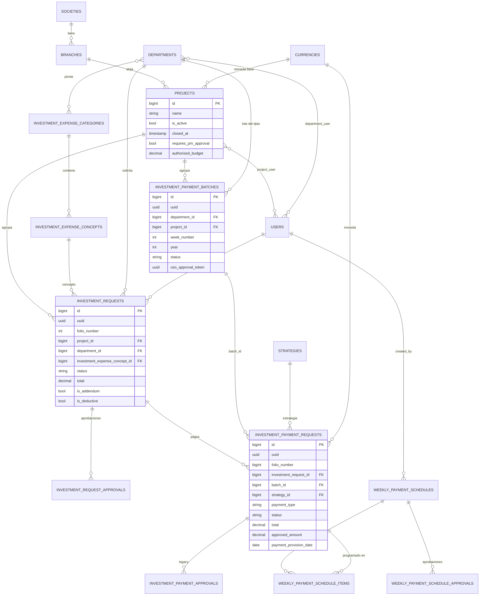
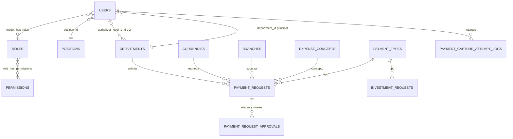

# Modelo de datos

Mapa de las tablas principales del portal y cómo se relacionan. El detalle de cada tabla (columnas, casts, métodos) está en su nota dentro de `04 Datos/Modelos`.

## Dominios

| Dominio | Tablas |
|---|---|
| Organización y catálogos | `societies`, `branches`, `currencies`, `departments`, `positions`, `expense_concepts`, `payment_types`, `investment_expense_categories`, `investment_expense_concepts`, `strategies` |
| Usuarios y acceso | `users`, `department_user`, `project_user`, `roles`, `permissions`, `model_has_roles`, `role_has_permissions` |
| Proyectos e inversión | `projects`, `investment_requests`, `investment_request_approvals` |
| Pagos de inversión | `investment_payment_batches`, `investment_payment_requests`, `investment_payment_approvals` (legacy) |
| Programación y banco | `weekly_payment_schedules`, `weekly_payment_schedule_items`, `weekly_payment_schedule_approvals` |
| Política de ventanas | `payment_request_policies`, `payment_capture_attempt_logs` |
| Legacy pagos | `payment_requests`, `payment_request_approvals` |
| Infraestructura | `activity_log`, `notifications`, `jobs`, `job_batches`, `failed_jobs`, `cache`, `sessions`, `imports`, `exports`, `failed_import_rows` |

## Diagrama ER: inversión y pagos

## Diagrama ER: catálogos y legacy

## Resumen de tablas principales

| Tabla | Modelo | Soft deletes | Activity log | Llave de ruta |
|---|---|---|---|---|
| `users` | [[User]] | Sí | Sí | id |
| `roles` | [[Role]] | No | Sí | id |
| `departments` | [[Department]] | Sí | Sí | id |
| `positions` | [[Position]] | Sí | Sí | id |
| `societies` | [[Society]] | Sí | Sí | id |
| `branches` | [[Branch]] | Sí | Sí (sin `sap_password`) | id |
| `currencies` | [[Currency]] | Sí | Sí | id |
| `expense_concepts` | [[ExpenseConcept]] | Sí | Sí | id |
| `payment_types` | [[PaymentType]] | Sí | Sí | id |
| `investment_expense_categories` | [[InvestmentExpenseCategory]] | Sí | Sí | id |
| `investment_expense_concepts` | [[InvestmentExpenseConcept]] | Sí | Sí | id |
| `strategies` | [[Strategy]] | Sí (sin borrado definitivo) | Sí | id |
| `projects` | [[Project]] | Sí | Sí | id |
| `investment_requests` | [[InvestmentRequest]] | Sí | Sí | uuid |
| `investment_request_approvals` | [[InvestmentRequestApproval]] | No | Sí | id |
| `investment_payment_batches` | [[InvestmentPaymentBatch]] | No | Sí | uuid |
| `investment_payment_requests` | [[InvestmentPaymentRequest]] | Sí | Sí | uuid |
| `investment_payment_approvals` | [[InvestmentPaymentApproval]] | No | Sí | id |
| `weekly_payment_schedules` | [[WeeklyPaymentSchedule]] | Sí | Sí | uuid |
| `weekly_payment_schedule_items` | [[WeeklyPaymentScheduleItem]] | No | Sí | id |
| `weekly_payment_schedule_approvals` | [[WeeklyPaymentScheduleApproval]] | No | Sí | id |
| `payment_requests` | [[PaymentRequest]] | Sí | Sí | uuid |
| `payment_request_approvals` | [[PaymentRequestApproval]] | No | Sí | id |
| `payment_request_policies` | [[PaymentRequestPolicy (modelo)]] | No | No | — |
| `payment_capture_attempt_logs` | [[PaymentCaptureAttemptLog]] | No | No | — |

## Convenciones del modelo

- **Folios**: `folio_number = max(folio_number incluidos borrados) + 1` en `creating` (solicitudes y pagos).
- **UUID como llave de ruta** en entidades expuestas por URL o correo.
- **Normalización de texto** con mutators: nombres y proveedores en MAYÚSCULAS, correos en minúsculas.
- **Montos** en `decimal(12|14,2)`; tipo de cambio `decimal(12,4)`; sumas a MXN con `total × exchange_rate`. Ver [[Multimoneda]].
- **Borrado**: casi todo usa `SoftDeletes`; la regla del proyecto prohíbe borrar registros. Ver [[Proteccion de la base de datos]].
- **Estados**: dos modelos usan spatie/model-states; los pagos de inversión, lotes y programación usan strings. Ver [[Estados]].

## Relacionado
- [[Estados]] · [[Enums]] · [[Migraciones]] · [[Auditoria y activity log]] · [[Backend Laravel]]
