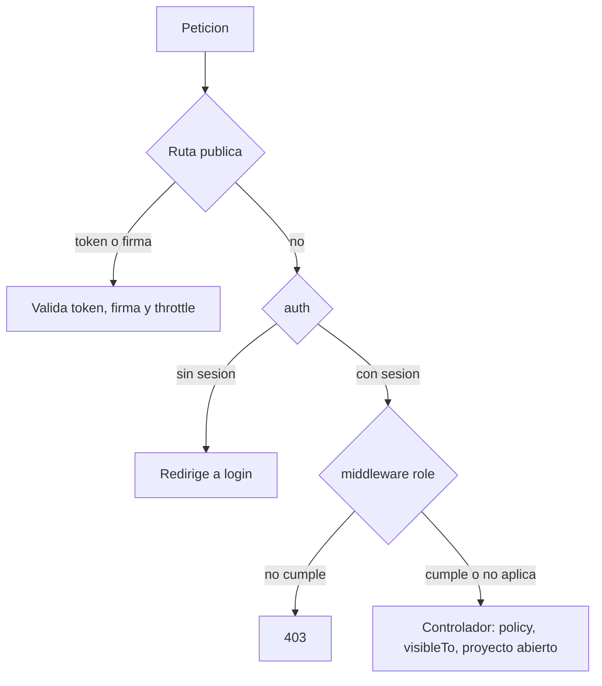

# Middleware y rutas protegidas

Qué middleware protege cada grupo de rutas del portal Inertia y del panel Filament, y cuáles rutas son públicas con token.

## Middleware registrado (`bootstrap/app.php`)

| Middleware | Alcance | Qué hace |
|---|---|---|
| `SecurityHeaders` | Global (`append`) | `X-Frame-Options: DENY` (si la respuesta no trae otro), `X-Content-Type-Options: nosniff`, `Referrer-Policy`, `Permissions-Policy`, HSTS en HTTPS |
| `HandleAppearance` | Grupo `web` | Tema claro/oscuro |
| `HandleInertiaRequests` | Grupo `web` | Comparte `auth.user` (id, nombre, correo, departamentos, **roles**), notificaciones no leídas y flash |
| `AddLinkHeadersForPreloadedAssets` | Grupo `web` | Preload de Vite |
| `encryptCookies(except: appearance, sidebar_state)` | Global | |
| Alias `role`, `permission`, `role_or_permission` | Rutas | Middleware de spatie/laravel-permission |

> [!info] `verified`
> `User` no implementa `MustVerifyEmail`, por lo que `verified` deja pasar a todo usuario autenticado. En la práctica el grupo protegido equivale a `auth`.

## Rutas públicas

| Ruta | Middleware | Protección |
|---|---|---|
| `GET /` | — | Redirige a `login` |
| `GET /up` | — | Health check de Laravel |
| `GET /documents/view` | — | **URL firmada** (`hasValidSignature()`); rechaza rutas con `..` o absolutas; sirve PDF/imagen inline con `X-Frame-Options: SAMEORIGIN` |
| `GET /approval/{token}` y `POST /approval/{token}/approve`, `/reject` | `throttle:10,1` | Token de aprobación válido y no expirado; busca en `payment_request_approvals`, `investment_request_approvals`, `investment_payment_approvals` y `weekly_payment_schedule_approvals` |
| `GET /investment-batch-approval/{token}`, `POST .../{token}/review`, `GET .../success` | `throttle:10,1` | Token del lote (`ceo_approval_token`), vigente (96 h) y lote en `submitted` |
| Rutas de Fortify (login, reset, 2FA) | Limitadores `login` y `two-factor` (5/min) | Ver [[Autenticacion y 2FA]] |

> [!tip]
> Las rutas con token no requieren sesión: el CEO y los autorizadores pueden responder desde el correo. El token se limpia al responder.

## Rutas autenticadas (`auth` + `verified`)

| Grupo | Rutas | Middleware extra | Autorización adicional |
|---|---|---|---|
| Dashboard | `dashboard` | — | Contenido según rol |
| Proveedores | `providers/search` | `throttle:30,1` | — |
| Pagos legacy | `payment-requests.*`, `approve`, `reject`, `sap-folios`, `pdf`, `documents/{index}` | `throttle:10,1` en approve/reject | `PaymentRequestPolicy` |
| Dashboard de inversión | `investment-dashboard` | — | `super_admin`/`project_manager` ven todo; resto por `visibleTo` |
| Consolidado | `investment-sheets/consolidated`, `{project}`, `payment-history-pdf`, `payment-history-excel` | — | `visibleTo` + roles para ver todos los departamentos |
| Reportes de solicitudes | `investment-sheets/consolidated/{project}/investment-requests-pdf`, `-excel` | `role:super_admin\|ceo\|project_manager` | |
| Pagos de inversión | `investment-payment-requests.index`, `store`, `update` | — | Acceso al proyecto, proyecto abierto, política de ventanas |
| Corrección de fecha de provisión | `investment-payment-requests/{payment}/provision-date` | `role:super_admin` | Además `abort_unless(hasRole('super_admin'))` |
| Lotes | `investment-payment-batches/payments/{payment}` (DELETE), `{batch}/submit` | — | Dueño o miembro del departamento; estado `draft`; ventana de envío |
| Documentos del pago | `investment-payment-requests/{payment}/upload-documents` | — | Estado `final_approved` (más estados para `super_admin`) |
| Revisión PM | `investment-payment-review` (GET y POST) | `role:project_manager\|super_admin` | Proyecto abierto |
| Solicitudes de inversión | `investment-sheets.*` (resource), `description`, `approve`, `reject`, `pdf` | `throttle:10,1` en approve/reject | `InvestmentRequestPolicy` |
| Programación semanal | `weekly-payment-schedule` (index, export, store), `{payment}/receipt` | — | `visibleTo` por proyecto, proyecto abierto |
| Guía | `guide` | — | — |
| Notificaciones | `notifications/{id}/read`, `read-all` | — | Del usuario autenticado |

### Settings (`routes/settings.php`)

| Ruta | Middleware |
|---|---|
| `settings/profile` (GET, PATCH) | `auth` |
| `settings/profile` (DELETE), `settings/password`, `settings/appearance`, `settings/two-factor` | `auth` + `verified`; `PUT settings/password` con `throttle:6,1` |

## Panel Filament (`/admin`)

- Middleware del panel: cookies, sesión, `AuthenticateSession`, CSRF, `SubstituteBindings`, etc.; `authMiddleware`: `Filament\Http\Middleware\Authenticate`.
- Entrada: `User::canAccessPanel()` → `is_active`.
- Dentro: policies + permisos Shield por recurso; `PaymentPolicySettings` por rol. Ver [[Permisos Shield]].

## Relacionado
- [[Rutas]] · [[Roles y actores]] · [[Policies]] · [[Seguridad de la aplicacion]] · [[Autenticacion y 2FA]]
