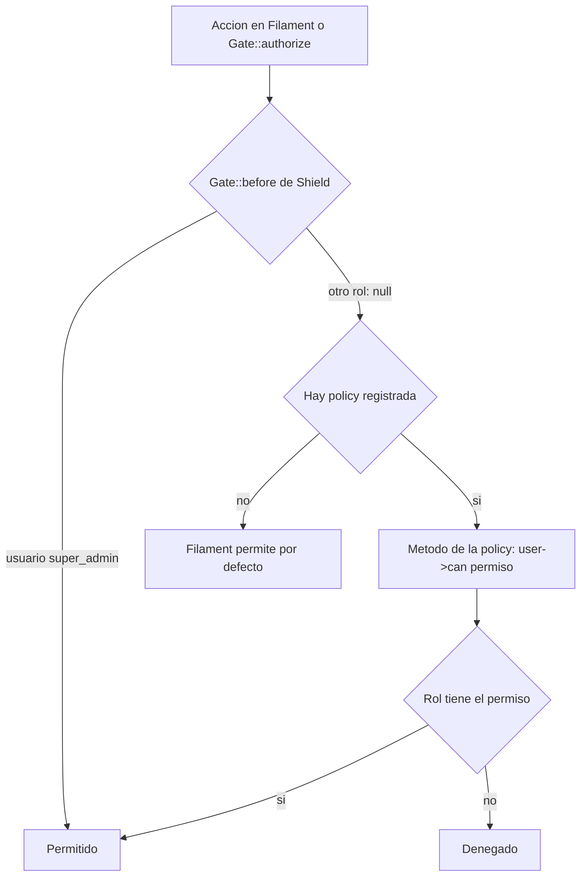

# Permisos Shield

Cómo se generan, nombran y asignan los permisos del panel Filament con `bezhansalleh/filament-shield` sobre `spatie/laravel-permission`.

## Configuración (`config/filament-shield.php`)

| Clave | Valor | Efecto |
|---|---|---|
| `shield_resource.slug` | `shield/roles` | UI de roles en `/admin/shield/roles` |
| `shield_resource.navigation_group` | `Accesos` | Grupo del menú |
| `super_admin.enabled` / `name` | `true` / `super_admin` | Rol con acceso total |
| `super_admin.define_via_gate` + `intercept_gate` | `true` + `before` | Registra `Gate::before`: si el usuario tiene `super_admin` devuelve `true`; si no, `null` (sigue la policy) |
| `panel_user.enabled` | `true` | Rol `panel_user` reservado |
| `permission_prefixes.resource` | `view`, `view_any`, `create`, `update`, `restore`, `restore_any`, `replicate`, `reorder`, `delete`, `delete_any`, `force_delete`, `force_delete_any` | 12 permisos por recurso |
| `permission_prefixes.page` / `widget` | `page` / `widget` | Prefijos para páginas y widgets |
| `entities` | pages, widgets, resources: `true`; `custom_permissions: false` | |
| `generator.option` | `policies_and_permissions` | `shield:generate` crea policy y permisos |
| `exclude.pages` / `widgets` | `Dashboard` / `AccountWidget`, `FilamentInfoWidget` | |
| `register_role_policy.enabled` | `true` | `Gate::policy(App\Models\Role, App\Policies\RolePolicy)` |

`config/permission.php` usa `App\Models\Role` como modelo de rol (ver [[Role]]).

## Convención de nombres

```
{prefijo}_{identificador}
```

- El identificador es el nombre del modelo del recurso en *snake case* con `::` como separador de palabras.
- Ejemplos reales: `view_any_branch`, `update_expense::concept`, `delete_investment::payment::request`, `restore_any_payment::type`, `view_activity`.
- `RoleResource` implementa `HasShieldPermissions` con solo 6 prefijos: `view`, `view_any`, `create`, `update`, `delete`, `delete_any`.

| Recurso Filament | Identificador | En `RoleAndPermissionSeeder` |
|---|---|---|
| `BranchResource` | `branch` | Sí |
| `CurrencyResource` | `currency` | Sí |
| `DepartmentResource` | `department` | Sí |
| `ExpenseConceptResource` | `expense::concept` | Sí |
| `PaymentRequestResource` | `payment::request` | Sí |
| `InvestmentRequestResource` | `investment::request` | Sí |
| `PaymentTypeResource` | `payment::type` | Sí |
| `PositionResource` | `position` | Sí |
| `RoleResource` | `role` | Sí (6 prefijos) |
| `SocietyResource` | `society` | Sí |
| `UserResource` | `user` | Sí |
| `ProjectResource` | `project` | No |
| `InvestmentExpenseCategoryResource` | `investment::expense::category` | No |
| `InvestmentExpenseConceptResource` | `investment::expense::concept` | No |
| `InvestmentPaymentBatchResource` | `investment::payment::batch` | No |
| `InvestmentPaymentRequestResource` | `investment::payment::request` | No |
| `StrategyResource` | `strategy` | No |
| `ActivityResource` (filament-logger) | `activity` | No |

> [!question] Por confirmar
> Los permisos de los recursos marcados "No" no están en el seeder; deben existir en la BD por `shield:generate` o por la UI. Si se reconstruye una base desde seeders, esos permisos faltarán para roles distintos de `super_admin`.

## Cómo se evalúa un permiso



> [!warning]
> Cuando un modelo no tiene policy registrada, Filament **permite** la acción. Es el caso de `ActivityResource` (ver [[Auditoria y activity log]]).

Algunos recursos sobrescriben la policy en la clase del recurso: `InvestmentPaymentRequestResource` e `InvestmentPaymentBatchResource` devuelven `false` en `canCreate`, `canEdit`, `canDelete`, `canDeleteAny` (solo lectura). La página `PaymentPolicySettings` no usa permisos Shield: `canAccess()` exige rol `super_admin` o `project_manager`.

## Dar permisos a un recurso nuevo

1. Crear el recurso Filament en `app/Filament/Resources` (se descubre automáticamente).
2. Generar policy y permisos:
   ```bash
   php artisan shield:generate --resource=NuevoResource --panel=admin --no-interaction
   ```
   Crea `app/Policies/NuevoPolicy.php` (12 métodos `$user->can('{prefijo}_{identificador}')`) y los registros en `permissions`.
3. Ajustar la policy si el recurso tiene reglas propias (ej. `StrategyPolicy` niega `forceDelete`).
4. Asignar los permisos a los roles en `/admin/shield/roles` (o agregarlos al seeder si deben reproducirse en ambientes nuevos).
5. Si el modelo no está en `App\Models` o la policy no sigue el nombre esperado, registrarla con `Gate::policy()`.
6. Probar con un usuario sin `super_admin` (con `super_admin` todo pasa por `Gate::before`).

> [!tip]
> En el portal Inertia (fuera de `/admin`) casi no se usan permisos Shield: allí mandan los roles (`role:` en rutas, `hasRole`/`hasAnyRole` en controladores) y los scopes de visibilidad. Las excepciones son Panel, Solicitudes de Pago y la consulta de Estrategias. Ver [[Middleware y rutas protegidas]].

## Permisos del portal

Panel, Solicitudes de Pago y la consulta de Estrategias se habilitan por rol desde `/admin/shield/roles` ([[ADR-024 Panel y Solicitudes de Pago controlados desde Shield]], [[ADR-025 Consulta de Estrategias con permiso del portal]]).

- `User::hasPortalPermission()` usa `checkPermissionTo()` de Spatie: revisa los permisos reales de los roles del usuario, no pasa por `Gate::before` y también aplica a `super_admin`.
- `HandleInertiaRequests` comparte el resultado en `auth.can` (`viewDashboard`, `viewStrategies`, `viewPaymentRequests`, `createPaymentRequests`, `viewPaymentRequestDetail`, `updatePaymentRequests`).
- Los permisos de varios roles se suman.

| Tarjeta | Permisos | Origen |
|---|---|---|
| Panel | `view_portal::dashboard` | No corresponde a un recurso de Filament: `RoleResource` agrega la tarjeta desde `PORTAL_PERMISSION_CARDS`, y la migración `add_portal_dashboard_permission` crea el permiso |
| Estrategias (portal) | `view_portal::strategies` | Igual que Panel, con la migración `add_portal_strategies_permission_and_role`. Es distinta de la tarjeta del catálogo `*_strategy`. Ver [[Estrategias]] |
| Solicitud de Pago | `*_payment::request` | `PaymentRequestResource`. Ver [[Modulo legacy Payment Requests]] |

> [!warning] Permisos fuera del formulario
> `EditRole` ejecuta `syncPermissions()` con los campos del formulario. Un permiso que no aparezca como casilla se borra del rol al guardarlo; por eso cualquier permiso nuevo del portal necesita su tarjeta en `RoleResource`.

## Relacionado
- [[Roles y actores]] · [[Policies]] · [[Panel Filament]] · [[Role]]
