# Roles y actores

Quién es quién en el portal: los roles de spatie/laravel-permission, los actores que no dependen de un rol (autorizadores por departamento o por configuración) y qué aprueba cada uno.

## Roles

| Rol | Origen | Permisos Shield en seeder | Efecto en código |
|---|---|---|---|
| `super_admin` | `RoleAndPermissionSeeder` | Todos los de catálogos, usuarios, roles, `payment::request`, `investment::request` | **Pasa cualquier `Gate`/policy** vía `Gate::before` de Shield. Bypass en `visibleTo`, acceso a proyectos, corrección de fecha de provisión, carga de documentos en estados extra, edición directa del estado en Filament |
| `ceo` | `CeoRoleSeeder` (sin permisos) | Ninguno | Recibe el correo del lote enviado y aprueba/rechaza por enlace con token. Acceso elevado a proyectos; ve todos los departamentos en el consolidado y descarga reportes |
| `project_manager` | `ProjectManagerRoleSeeder` (sin permisos; asigna el rol a un usuario por correo) | Ninguno | Revisión y aprobación final de pagos (`/investment-payment-review`), edita la política de ventanas, abre/cierra proyectos, aprueba solicitudes de inversión de proyectos con `requires_pm_approval`, acceso elevado a proyectos, dashboard completo |
| `administrador` | `RoleAndPermissionSeeder` | `*_payment::request` y `*_investment::request` (12 + 12) | Ningún chequeo por nombre de rol; solo lo que dan esos permisos |
| `admin_sp` | `RoleAndPermissionSeeder` | Mismos que `super_admin` en el seeder | **No se usa en el código** (sin `hasRole('admin_sp')`). Al no tener `Gate::before`, depende solo de sus permisos |
| `estrategias` | `RoleAndPermissionSeeder` y migración `add_portal_strategies_permission_and_role` | `view_portal::strategies` | Consulta de solo lectura en `/strategies`, de todas las Hojas y departamentos, con sus reportes. Sin acceso a `/admin` por este rol. Ver [[Estrategias]] |
| `panel_user` | `config/filament-shield.php` (`panel_user.enabled = true`) | — | Nombre reservado por Shield; `User` no usa `HasPanelShield`, así que no condiciona el acceso al panel |

> [!question] Por confirmar: rol `usuarios`
> No aparece en seeders ni en código. Si existe en producción, se creó desde la UI de Shield (`/admin/shield/roles`) y su alcance depende solo de los permisos asignados ahí.

> [!info] Permisos de `administrador`
> Según el seeder, `administrador` recibe permisos de **solicitudes de pago y de solicitudes de inversión**. Si en producción solo tiene `payment::request`, la diferencia viene de cambios hechos desde Shield. Por confirmar.

> [!warning] Excepción de `super_admin` en el portal
> Panel, la consulta de Estrategias y las casillas de lista y formulario de Solicitudes de Pago usan `User::hasPortalPermission()`, que no pasa por `Gate::before`. Si se desmarcan en su rol, `super_admin` deja de verlos en el portal, aunque conserva Solicitudes de Pago en `/admin`. Ver [[Permisos Shield]].

### Roles con acceso elevado

`User::hasElevatedAccess()` = `super_admin`, `ceo` o `project_manager`. Estos tres ven todos los proyectos sin asignación en `project_user` (ver [[Acceso por proyecto]]).

### Protecciones del rol `super_admin`

- `Role` aplica el global scope `hide_super_admin`: quien no es `super_admin` no ve ese rol en listas ni selects.
- `UserResource` impide que un `super_admin` se quite a sí mismo el rol.
- Acceso al panel `/admin`: cualquier usuario con `is_active = true` (`User::canAccessPanel()`); lo visible depende de permisos.

## Actores sin rol

| Actor | Cómo se determina | Qué aprueba |
|---|---|---|
| Autorizador nivel 1 / nivel 2 del departamento | `departments.authorizer_level_1_id` / `_2_id` | Etapa *department* de solicitudes de pago legacy; también da visibilidad a solicitudes del departamento |
| Autorizadores de `ADMINISTRACIÓN` y `TESORERÍA` | Autorizadores de los departamentos con esos nombres | Etapas *administration* y *treasury* del flujo legacy |
| Autorizador global de inversión | Usuario cuyo correo está en `INVESTMENT_AUTHORIZER_EMAIL` (`config('investment-requests.authorizer_email')`) | Solicitudes de inversión (flujo por defecto) y programaciones semanales de pago |
| Capturista | Cualquier usuario con acceso al proyecto y al departamento | Crea borradores y envía su lote (dueño del lote o miembro del departamento) |

## Matriz de aprobaciones

| Qué | Quién aprueba | Cómo | Código |
|---|---|---|---|
| Solicitud de pago legacy | Autorizadores del departamento → Administración → Tesorería (nivel 1 y opcional nivel 2 en cada etapa) | Portal o enlace por correo | `ApprovalService` |
| Solicitud de inversión | (a) PM si el proyecto tiene `requires_pm_approval`; (b) aprobación automática si `INVESTMENT_REQUEST_REQUIRE_AUTHORIZATION` es falso; (c) autorizador global | Portal o enlace por correo | `InvestmentApprovalService::createApprovals()` |
| Lote de pagos (1.ª ronda) | Todos los usuarios con rol `ceo` reciben el enlace | Enlace con token (96 h), sin sesión | `InvestmentBatchApprovalController` |
| Pagos aprobados por CEO (aprobación final) | `project_manager` o `super_admin` | Portal `/investment-payment-review`; puede ajustar `approved_amount` | `InvestmentPaymentReviewController` |
| Carga de documentos | Capturista con acceso (`super_admin` en más estados) | Portal | `InvestmentPaymentDocumentController` |
| Programación semanal | Autorizador global de inversión | Enlace por correo (48 h) | `WeeklyPaymentScheduleApprovalService` |
| Comprobante de pago | Usuario con visibilidad del proyecto | Portal | `WeeklyPaymentReceiptController` |

```mermaid
flowchart LR
    CAP["Capturista"] -->|"envia lote"| CEO["Rol ceo"]
    CEO -->|"aprueba"| PM["Rol project_manager"]
    PM -->|"aprobacion final"| DOC["Carga de documentos"]
    DOC --> PROG["Programacion semanal"]
    PROG -->|"enlace"| AUT["Autorizador global"]
    AUT --> BANCO["scheduled_for_bank"]
    BANCO --> COMP["Comprobante"]
```

## Notificaciones por rol

- `ceo`: lote enviado (`InvestmentBatchSubmittedNotification`).
- `project_manager`: lote listo para revisión, resumen de aprobación final por departamento, resumen de borradores cancelados automáticamente, solicitudes de inversión de proyectos con candado PM.

Ver [[Catalogo de correos]] y [[Notificaciones in-app]].

## Seeders

`DatabaseSeeder` ejecuta catálogos y `RoleAndPermissionSeeder`, y crea un usuario inicial con rol `super_admin`. `CeoRoleSeeder` y `ProjectManagerRoleSeeder` se ejecutan por separado. Ninguno borra roles; `syncPermissions()` sí reemplaza los permisos de los roles que define.

> [!warning]
> Volver a correr `RoleAndPermissionSeeder` **reemplaza** los permisos de `super_admin`, `admin_sp` y `administrador` por los de la lista del seeder, que no incluye recursos nuevos (proyectos, categorías y conceptos de inversión, lotes, pagos, estrategias, actividad). Para `super_admin` no importa (pasa por `Gate::before`); para los otros dos se perderían permisos asignados desde la UI.

## Relacionado
- [[Permisos Shield]] · [[Policies]] · [[Middleware y rutas protegidas]] · [[Role]] · [[User]] · [[Aprobacion del CEO]] · [[Revision del PM]]
