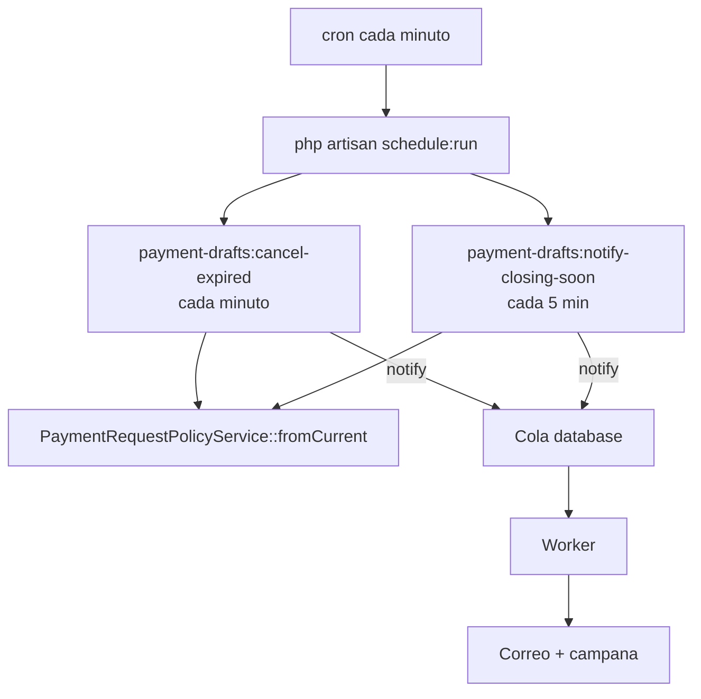

# Comandos y scheduler

Comandos Artisan propios del proyecto (`app/Console/Commands`, se registran solos en Laravel 12) y tareas programadas en `routes/console.php`. Los dos comandos programados implementan la parte automática de la [[Politica de ventanas de pago]].

## Resumen

| Comando | Programado | Frecuencia | Escribe en BD | Envía notificaciones |
|---|---|---|---|---|
| `payment-drafts:cancel-expired` | Sí | Cada minuto | Sí (cancela borradores) | Sí (solicitante + PMs) |
| `payment-drafts:notify-closing-soon` | Sí | Cada 5 minutos | No (solo caché) | Sí (dueños de borradores) |
| `investment:generate-payments-template` | No (manual) | — | No (solo lectura) | No |
| `inspire` | No | — | No | No (comando de ejemplo de Laravel) |

## Programación (`routes/console.php`)

```php
Schedule::command('payment-drafts:cancel-expired')
    ->everyMinute()->withoutOverlapping()->runInBackground();

Schedule::command('payment-drafts:notify-closing-soon')
    ->everyFiveMinutes()->withoutOverlapping()->runInBackground();
```

- `withoutOverlapping()` usa un lock en la caché (driver `database` por defecto) para no correr dos instancias a la vez.
- `runInBackground()` lanza cada comando como proceso aparte para no bloquear al scheduler.
- Para que corran se necesita el scheduler activo:
  - Producción: cron que ejecute `php artisan schedule:run` cada minuto. Ver [[Produccion]] y [[Deploy]].
  - Local: `php artisan schedule:work` (no está incluido en `composer dev`). Ver [[Desarrollo local]].
- Las notificaciones que disparan son `ShouldQueue`: además del scheduler debe estar corriendo el worker de colas. Ver [[Colas y correo]].



## `payment-drafts:cancel-expired`

Cancela automáticamente los pagos de inversión en **borrador** que no se enviaron a autorización antes del cierre de la ventana de envío. Flujo de negocio completo en [[Cancelacion automatica de borradores]].

| Opción | Efecto |
|---|---|
| `--dry-run` | Lista folio, proveedor, solicitante y total de lo que se cancelaría; no toca BD ni envía correos. |

Lógica (`CancelExpiredPaymentDraftsCommand::handle()`):

1. Obtiene la política con `PaymentRequestPolicyService::fromCurrent()` (caché de 60 s).
2. Si la ventana de envío **no está activa** (`submit_window_is_active = false`) → no hace nada.
3. Si **ahora** está dentro de la ventana de envío (o en periodo extendido/snooze) → no hace nada.
4. Calcula el último cierre (`getCurrentSubmitClosesAt()`; si queda en el futuro, resta una semana).
5. Si la política no tiene `cancellation_activated_at` → no hace nada. Esa marca se pone sola la primera vez que se activa la ventana de envío desde `PaymentPolicySettings::save()`, para no cancelar borradores anteriores a la activación.
6. Busca `InvestmentPaymentRequest` con `status = 'draft'` y `created_at` entre `cancellation_activated_at` y el último cierre.
7. En una transacción:
   - Cada pago pasa a `status = 'auto_cancelled'`, con `auto_cancelled_at = now()` y `auto_cancellation_reason` = "Ventana de envío cerró el {fecha es_MX} sin que el draft fuera enviado al CEO."
   - Por cada lote afectado: si ya no le queda ningún pago activo (todos en `rejected`, `ceo_rejected`, `projectmanager_rejected`, `final_rejected` o `auto_cancelled`) y el lote sigue en `draft`, el lote pasa a `auto_cancelled`.
8. Notificaciones (fuera de la transacción):
   - A cada solicitante: `DraftPaymentsAutoCancelledNotification` con sus pagos cancelados.
   - A **todos** los usuarios con rol `project_manager`: `DraftPaymentsAutoCancelledPmSummaryNotification` con el total de pagos cancelados.

Es idempotente: una vez cancelados, los pagos ya no están en `draft`, así que las ejecuciones siguientes no encuentran nada.

> [!question] Por confirmar
> El resumen a PMs se envía a todos los `project_manager` sin filtrar por proyecto o departamento de los pagos cancelados. Confirmar si cada PM debe recibir solo lo de sus proyectos (ver [[Acceso por proyecto]]).

## `payment-drafts:notify-closing-soon`

Recordatorio a quienes tienen borradores sin enviar, unas **2 horas antes** del cierre de la ventana de envío.

Lógica (`NotifyClosingSoonReminderCommand::handle()`):

1. Sale si la ventana de envío no está activa o si ahora **no** está dentro de la ventana.
2. Calcula minutos al cierre; solo actúa si faltan entre **110 y 130 minutos** (la frecuencia de 5 min garantiza caer en ese rango).
3. Idempotencia por caché con la llave `closing_soon_reminder_sent:{fecha ISO del cierre}`; si existe, sale.
4. Busca todos los `InvestmentPaymentRequest` en `draft`, agrupados por usuario, y envía `DraftPaymentsClosingSoonReminderNotification` (correo + campana) a cada dueño.
5. Guarda la llave de caché "hasta el cierre + 1 h".

> [!danger] Posible bug: el recordatorio puede enviarse varias veces
> El TTL se calcula como `$closesAt->diffInSeconds($now) + 3600`. Con Carbon 3 (instalado 3.11.3) `diffInSeconds()` devuelve un valor **con signo**: `$closesAt->diffInSeconds($now)` es negativo (unas -7,200 s cuando faltan 2 h), así que el TTL queda en unos -3,600 s. `Cache::put()` con TTL menor o igual a 0 **borra** la llave en lugar de guardarla. Resultado: la idempotencia no funciona y cada ejecución dentro del rango 110–130 min (hasta 4–5 corridas) vuelve a enviar el recordatorio. Corrección sugerida: `$now->diffInSeconds($closesAt) + 3600` o `abs(...)`, o guardar con `->addHour()` como fecha de expiración. Validar con un test antes de cambiar.

> [!note] Alcance
> El recordatorio no filtra por la fecha de activación ni por lote: avisa a todo usuario con cualquier borrador abierto.

## `investment:generate-payments-template`

Genera un XLSX para la **carga masiva de pagos históricos de inversión**. Comando manual, de solo lectura sobre la BD.

| Aspecto | Detalle |
|---|---|
| Salida | `public/downloads/templates/investment_payments_historical.xlsx` (crea el directorio si no existe) e imprime la URL pública. |
| Librería | `OpenSpout\Writer\XLSX\Writer` (`openspout/openspout`, dependencia transitiva de `filament/actions`, no declarada en `composer.json`). |
| Hoja `instrucciones` | Pasos de llenado y diccionario de columnas (obligatoriedad y formato). |
| Hoja `pagos` | Encabezados técnicos (fila 1) y etiquetas en español (fila 2): `investment_request_folio`, `provider`, `rfc`, `invoice_folio`, `payment_type`, `payment_provision_date`, `description`, `subtotal`, `iva_rate`, `iva`, `retention`, `total`, `created_by_email`, `currency`, `branch`, `created_at`. |
| Hoja `conceptos_referencia` | Una fila por `InvestmentRequest` con folio, proveedor, descripción, proyecto, gasto de inversión, categoría, sucursal, moneda, total del concepto, pagado al día y saldo disponible, y correo del solicitante. |
| Saldos | Se agrupan por **proyecto + gasto de inversión** (`groupKey()`); "pagado" suma pagos en `pending_approval` y `approved`. Los montos se suman en su moneda nativa, sin tipo de cambio (ver [[Multimoneda]]). |
| Valores válidos documentados | `payment_type`: factura, reembolso, estrategia, anticipo, cotizacion, pagare, domiciliado, factura_espana, nomina_fiscal. `iva_rate`: 0.00, 0.04, 0.08, 0.10, 0.16, 0.21. |

Uso esperado: se genera el XLSX, se llena la hoja `pagos` y el resultado se guarda como `database/seeders/data/investment_payments_historical.tsv`, que es lo que lee `Database\Seeders\BulkImport\InvestmentPaymentsHistoricalSeeder` (carga los pagos con estatus aprobado y su aprobación, sin notificaciones). Ver [[Respaldos y restauracion]] antes de cualquier carga.

> [!warning] Archivo con datos reales en carpeta pública
> El XLSX queda en `public/`, que el servidor web sirve **sin autenticación**, e incluye correos de solicitantes, proveedores y saldos. `public/downloads/.gitignore` evita que se versione, pero no que se descargue. Borrarlo en cuanto se use y no generarlo en producción salvo necesidad. Ver [[Seguridad de la aplicacion]].

> [!question] Por confirmar
> La plantilla y el seeder (`InvestmentPaymentsHistoricalSeeder::groupKey()`) agrupan saldos por proyecto + gasto, **sin departamento** y en moneda nativa, mientras que el portal (`InvestmentRequest::budgetBreakdown()`) agrupa por proyecto + gasto + **departamento**, en MXN y solo con solicitudes `Completed`. Una carga histórica podría pasar la validación del seeder y aun así dejar un grupo del portal en saldo negativo. Ver [[Presupuesto por concepto]].

## Comandos de terceros relevantes

| Comando | Para qué |
|---|---|
| `php artisan queue:work` / `queue:listen` | Worker de colas (ver [[Colas y correo]]). |
| `php artisan queue:failed`, `queue:retry` | Revisar y reintentar jobs fallidos. |
| `php artisan schedule:list` | Ver las tareas programadas y su próxima ejecución. |
| `php artisan shield:generate` | Regenerar permisos y policies de Filament Shield (ver [[Permisos Shield]]). |
| `php artisan filament:upgrade` | Republicar assets de Filament (corre en `post-autoload-dump`). |

> [!danger] Comandos destructivos
> En producción `migrate:fresh`, `migrate:refresh`, `migrate:reset`, `migrate:rollback` y `db:wipe` están bloqueados por `DB::prohibitDestructiveCommands()`. Aun así, la regla del proyecto es nunca borrar registros. Ver [[Proteccion de la base de datos]].

## Relacionado
- [[Politica de ventanas de pago]] · [[Cancelacion automatica de borradores]] · [[Colas y correo]] · [[Catalogo de correos]] · [[Zona horaria y locale]] · [[Produccion]] · [[Deploy]]
