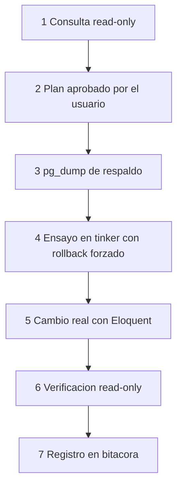

# Correcciones de datos en producción

Procedimiento genérico para consultar y, cuando sea inevitable, corregir datos en la base de producción sin perder trazabilidad ni romper la regla de nunca borrar registros. Esta nota describe el **método**; no documenta casos reales.

> [!danger] Antes de empezar
> - Nunca `DELETE`, `TRUNCATE`, `forceDelete()` ni SQL de escritura directa. Ver [[Proteccion de la base de datos]].
> - Toda corrección requiere **plan aprobado** por el usuario y **respaldo previo**.

## Flujo



## 1. Consultas de solo lectura

La sesión de `psql` se abre con transacciones de solo lectura forzadas, de modo que un error de tecleo no pueda escribir:

```bash
ssh <servidor> 'docker exec -i -e PGOPTIONS="-c default_transaction_read_only=on" \
  agent-data-db psql -U paymentrequest -d paymentrequest -P pager=off' < consulta.sql
```

- La consulta va en un archivo `.sql` local que se envía por stdin.
- `-P pager=off` evita que `psql` se quede esperando en el paginador.

> [!warning] Fechas de `activity_log`
> `activity_log.created_at` en producción está en hora CDMX pero se muestra con sufijo `+00`. Para ubicar un evento, buscar por `id`. Ver [[Auditoria y activity log]].

## 2. Plan

Presentar al usuario: registros afectados (por id), estado actual, estado esperado, script propuesto y forma de verificar. No avanzar sin un "sí" explícito.

## 3. Respaldo

Seguir [[Respaldos y restauracion]] con un `<motivo>` descriptivo.

## 4 y 5. Script de tinker

Se ejecuta dentro del contenedor web:

```bash
ssh <servidor> 'docker exec -i paymentrequest php artisan tinker' < script.php
```

Estructura del script (ejemplo ficticio):

```php
use App\Models\InvestmentPaymentRequest;
use App\Models\User;
use Illuminate\Support\Facades\Auth;
use Illuminate\Support\Facades\DB;

Auth::login(User::findOrFail(<id del usuario que solicita el cambio>));

echo "===FIX_START===\n";

DB::transaction(function () {
    $pago = InvestmentPaymentRequest::query()->lockForUpdate()->findOrFail(<id>);

    throw_unless($pago->status === '<estado esperado>', \Exception::class, 'Estado inesperado: '.$pago->status);

    $pago->update(['<campo>' => '<valor nuevo>']);

    echo "OK id={$pago->id}\n";

    throw new \Exception('SIMULACION_ROLLBACK');
});

echo "===FIX_END===\n";
```

| Elemento | Por qué |
|---|---|
| `Auth::login(<usuario que solicita>)` | Spatie Activity Log registra a ese usuario como actor del cambio |
| Eloquent (`update`) en vez de SQL | Dispara casts, observers y activity log |
| `DB::transaction` + `lockForUpdate` | Atomicidad y sin carreras con usuarios activos |
| `throw_unless` del estado esperado | Si el dato ya cambió desde la consulta, aborta sin tocar nada |
| `===FIX_START===` / `===FIX_END===` | Delimitan la salida útil entre el ruido de tinker |
| `throw new \Exception('SIMULACION_ROLLBACK')` | **Paso 4 (ensayo):** recorre toda la lógica y deshace la transacción |

Para el **paso 5** se quita únicamente la línea `SIMULACION_ROLLBACK` y se vuelve a ejecutar.

> [!warning] Escribir el script como archivo
> Crear `script.php` con un editor o heredoc entre comillas simples. No usar `echo "..." > script.php` en zsh: interpreta secuencias como `\U` dentro de namespaces (`App\Models\User`) y corrompe el código.

## 6. Verificación

Repetir la consulta read-only del paso 1 y confirmar el estado final y la nueva entrada en `activity_log` (por id).

## 7. Bitácora

Registrar fuera del repo qué se cambió, cuándo, a petición de quién y el nombre del dump. Los casos concretos **no** se documentan en esta bóveda.

## Relacionado
- [[Produccion]] · [[Respaldos y restauracion]] · [[Proteccion de la base de datos]]
- [[Auditoria y activity log]] · [[Estados]]
