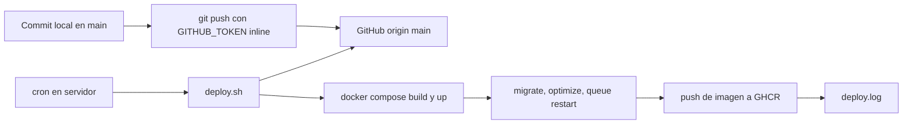

# Deploy

Cómo llega un cambio de `main` a producción: push desde local con el token del proyecto y deploy automático por cron en el servidor mediante `/srv/paymentrequest/deploy.sh`. El script vive en el servidor, no en el repo.

## Panorama



## 1. Push desde el equipo local

Las reglas están en `CLAUDE.md` del repo (sección *Git Authentication*):

- Toda operación remota (push, pull, fetch, ls-remote) se autentica con la variable `GITHUB_TOKEN` del `.env` local, usada **inline** en la URL remota.
- El token se lee en tiempo de ejecución con `grep '^GITHUB_TOKEN=' .env | cut -d'=' -f2-` y la salida se enmascara (`sed "s|${GITHUB_TOKEN}|***TOKEN***|g"`).
- **Nunca** persistir el token en `~/.git-credentials` ni en `.git/config`, ni imprimirlo o commitearlo.

> [!warning] Autorización de commits
> Solo se commitea y se hace push cuando el usuario lo pide explícitamente. Ver las reglas de trabajo del proyecto en `CLAUDE.md`.

## 2. Deploy automático en el servidor

Un cron ejecuta `/srv/paymentrequest/deploy.sh`. Pasos:

| # | Paso | Notas |
|---|---|---|
| 1 | `flock` sobre `.deploy.lock` | Evita dos deploys simultáneos |
| 2 | `git fetch` en `/mnt/storage-e/srv/paymentrequest/src/` | Si no hay commits nuevos, termina sin hacer nada |
| 3 | `git pull --ff-only` | Nunca hace merge ni rebase; si la historia diverge, falla |
| 4 | Copia `Dockerfile` y `.dockerignore` al build context | El Dockerfile vive en `/srv/paymentrequest/` |
| 5 | `docker compose build && docker compose up -d` | Reconstruye la imagen `paymentrequest:latest` (assets con Node 22) y recrea web, worker y scheduler |
| 6 | `php artisan migrate --force` | Aplica migraciones pendientes |
| 7 | `php artisan optimize` | Cachea config, rutas y vistas |
| 8 | `php artisan queue:restart` | El worker toma el código nuevo |
| 9 | Tag y push de la imagen a GHCR `ghcr.io/aramossysadmin/paymentrequest` (`:latest` y `:<sha>`) | **No fatal**: si falla, el deploy sigue |
| 10 | Escribe en `deploy.log` la línea `[FECHA] deploy OK -> <sha>` | |

> [!question] Por confirmar
> El push de la imagen a GHCR **ha fallado** en algunas ejecuciones. Revisar `deploy.log` y la autenticación del servidor contra GHCR; sin esas imágenes el rollback B (abajo) no está disponible para ese sha.

> [!danger] Migraciones en deploy
> El paso 6 corre `migrate --force` automáticamente. Antes de hacer push de una migración, sacar respaldo manual de la BD ([[Respaldos y restauracion]]) y verificar que la migración sea **aditiva** ([[Proteccion de la base de datos]]).

### Forzar un deploy manual

```bash
bash /srv/paymentrequest/deploy.sh
```

Revisar el resultado en `/srv/paymentrequest/deploy.log`.

## 3. Rollback

| Opción | Cuándo | Cómo |
|---|---|---|
| **A. `git revert` + push** | Opción natural, siempre preferida | Revertir el commit en local, push; el cron despliega la reversión |
| **B. Imagen previa de GHCR** | Solo emergencias breves | `docker pull ghcr.io/aramossysadmin/paymentrequest:<sha>`, retag a `paymentrequest:latest`, `docker compose up -d` |

> [!warning] Limitaciones del rollback B
> No revierte migraciones ya aplicadas, y el siguiente deploy del cron vuelve a construir desde `origin/main`. Úsalo solo para ganar tiempo mientras se prepara la opción A.

## Checklist antes de hacer push

- [ ] `vendor/bin/pint --dirty` ejecutado.
- [ ] Tests relacionados en verde (ver [[Tests]]).
- [ ] `npm run build` compila sin errores (el build de la imagen lo repite).
- [ ] Si hay migración: es aditiva y existe respaldo reciente.
- [ ] Código compatible con PHP 8.3 (runtime de producción).

## Relacionado
- [[Produccion]] · [[Respaldos y restauracion]] · [[Migraciones]]
- [[ADR-013 Migracion a Docker PostgreSQL y cron]] · [[Desarrollo local]]
