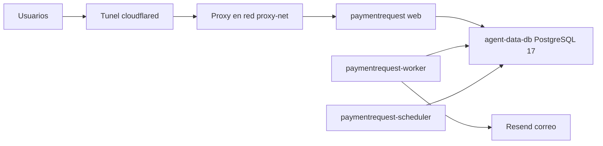

# Producción

Cómo está montado el entorno productivo del portal: servidor, contenedores, base de datos, correo y almacenamiento. La infraestructura vive **fuera del repositorio** (en el servidor); el repo solo aporta el código que se construye dentro de la imagen.

> [!danger] Contenido que NUNCA va en esta bóveda
> Contraseñas, llaves SSH o sus rutas, huellas, tokens ni valores del `.env` de producción. Aquí solo se documentan nombres de variables, rutas de trabajo y convenciones.

## Servidor

| Elemento | Valor |
|---|---|
| Sistema operativo | Ubuntu 26.04 con Docker |
| IP interna | `192.168.105.60` |
| Usuario de operación | `desarrollador` (acceso SSH por llave; la llave no está en el repo) |
| Stack Docker | `/srv/paymentrequest/` |
| Código fuente (build context) | `/mnt/storage-e/srv/paymentrequest/src/` — checkout de `origin/main` |
| Storage persistente | `/mnt/storage-e/srv/paymentrequest/storage/` montado en `/var/www/html/storage` |

Contenido de `/srv/paymentrequest/`:

| Archivo | Propósito |
|---|---|
| `docker-compose.yml` | Define los 3 servicios de la app y sus redes |
| `Dockerfile` | Multi-stage: etapa de build con Node 22 que compila los assets (Vite) y runtime `serversideup/php:8.3-fpm-nginx` |
| `.env` | Configuración de producción, inyectada vía `env_file`. **No es legible** por el usuario `desarrollador` |
| `.env.bak.<motivo>-<fecha>` | Respaldos del `.env` previos a cualquier cambio |
| `deploy.sh`, `deploy.log`, `.deploy.lock` | Deploy automático (ver [[Deploy]]) |
| `paymentrequest-pre-<motivo>-<fecha>.dump` | Respaldos de BD (ver [[Respaldos y restauracion]]) |

> [!warning] Versión de PHP
> El runtime de producción es **PHP 8.3** (imagen `serversideup/php:8.3-fpm-nginx`), mientras que el desarrollo local y el CI usan PHP 8.4. Evitar sintaxis exclusiva de 8.4 en código que se despliega.

## Contenedores

Los tres usan la misma imagen `paymentrequest:latest`.

| Contenedor | Rol | Comando |
|---|---|---|
| `paymentrequest` | Web (php-fpm + nginx) | default de la imagen |
| `paymentrequest-worker` | Cola de trabajos (correos, notificaciones) | `php artisan queue:work --tries=3 --timeout=300 --sleep=3 --max-time=3600` |
| `paymentrequest-scheduler` | Tareas programadas | `php artisan schedule:work` |

El scheduler ejecuta lo definido en `routes/console.php` (cancelación automática de borradores y recordatorio de cierre de ventana; ver [[Comandos y scheduler]] y [[Cancelacion automatica de borradores]]).

## Red y tráfico

- Los contenedores **no publican puertos** al host. El tráfico entra por un túnel `cloudflared` y un proxy conectado a la red Docker `proxy-net`.
- La red `analytics-net` conecta la app con el contenedor de base de datos.

## Base de datos

| Elemento | Producción | Local |
|---|---|---|
| Motor | PostgreSQL 17 (imagen `timescale/timescaledb-ha:pg17`) | SQLite |
| Contenedor | `agent-data-db` (compartido con otros sistemas) | — |
| Base / archivo | `paymentrequest` | `database/database.sqlite` |
| Rol | `paymentrequest` | — |

> [!info] Rol `postgres`
> En `agent-data-db` el rol `postgres` **no existe**. Toda operación usa `-U paymentrequest`, autenticando por socket dentro del contenedor (`docker exec agent-data-db ...`).

El driver se elige con `DB_CONNECTION` (`config/database.php`, default `sqlite`).

## Correo y colas

- Producción envía correo con **Resend** (`config/mail.php` → mailer `resend`; `config/services.php` → `resend`). Local usa Mailtrap sandbox (ver [[Desarrollo local]]).
- La conexión de cola por defecto es `database` (`config/queue.php`), atendida por `paymentrequest-worker`.
- Detalle funcional en [[Colas y correo]] y [[Catalogo de correos]].

## Zona horaria

La aplicación usa `America/Mexico_City` (ver [[Zona horaria y locale]]).

> [!warning] `activity_log.created_at` en producción
> Los valores se guardan en hora CDMX pero PostgreSQL los muestra con sufijo `+00`. Para localizar un evento concreto, buscar por `id` y no por rango de fecha. Ver [[Auditoria y activity log]].

## Historia

Hasta junio de 2026 producción era una VM con SQLite y deploy manual (servidor anterior ya retirado). Alrededor del 24 de junio de 2026 se migró a Docker + PostgreSQL + deploy automático por cron. Ver [[ADR-013 Migracion a Docker PostgreSQL y cron]].

## Relacionado
- [[Deploy]] · [[Respaldos y restauracion]] · [[Correcciones de datos en produccion]]
- [[Proteccion de la base de datos]] · [[APP_KEY y datos cifrados]] · [[Stack y versiones]]
