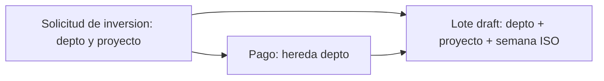

# ADR-011 Lote hereda el departamento de la solicitud

El pago de inversión y su lote toman el departamento de la **Solicitud de Inversión** a la que pertenecen, no el departamento del usuario que captura.

## Contexto
Un super_admin o un usuario multi-departamento puede capturar pagos sobre solicitudes de otros departamentos. Al usar el departamento del usuario, los pagos caían en lotes y presupuestos equivocados.

## Decisión
En `app/Http/Controllers/InvestmentPaymentRequestController.php`:
- `store()` asigna `$paymentRequest->department_id = $investmentRequest->department_id`.
- `findOrCreateActiveBatch()` busca o crea el lote `draft` por `department_id` y `project_id` de la solicitud + semana ISO y año actuales (`firstOrCreate`); el usuario solo queda como creador del lote (`user_id`).

## Consecuencias
- El presupuesto consumido y la aprobación por lote quedan en el departamento correcto, sin importar quién captura.
- Dos usuarios del mismo departamento comparten el lote de la semana para el mismo proyecto.

## Fecha
2026-06-22

## Fuentes
- Commit `e502cd2`.
- `InvestmentPaymentRequestController::findOrCreateActiveBatch()`

## Relacionado
- [[Indice de decisiones]] · [[Lotes de pago]] · [[InvestmentPaymentBatch]] · [[ADR-006 Pagos de inversion por lotes semanales]] · [[ADR-010 Usuarios con multiples departamentos]]
