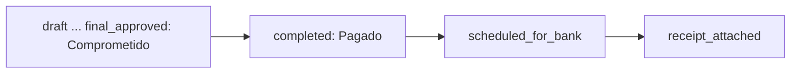

# ADR-014 Comprometido vs Pagado

El presupuesto de un concepto se consume en dos categorías: **Comprometido** (desde el borrador) y **Pagado** (desde la carga de documentos). Disponible = Presupuesto − Comprometido − Pagado.

## Contexto
Antes solo lo pagado consumía presupuesto. Un borrador no reservaba nada, así que se podía sobre-comprometer (dos borradores de $1,000.00 contra un presupuesto de $1,000.00). Además, distintas pantallas calculaban el saldo con filtros distintos (el dashboard usaba solo estados legacy).

## Decisión
- `InvestmentPaymentRequest::COMMITTED_STATUSES`: `draft`, `submitted`, `ceo_approved`, `projectmanager_review`, `projectmanager_approved`, `final_approved`, `documents_pending`.
- `InvestmentPaymentRequest::PAID_STATUSES`: `completed`, `scheduled_for_bank`, `receipt_attached` y los legacy `approved`, `pending_approval`.
- Rechazados y cancelados no cuentan (liberan saldo).
- **Única fuente de verdad**: `InvestmentRequest::budgetBreakdown(?int $excludePaymentId)` devuelve `budget`, `committed`, `paid`, `available` normalizados a MXN, con alcance proyecto + concepto + departamento. `excludePaymentId` excluye el propio borrador al editarlo.
- Toda validación (captura y edición) y toda pantalla reutilizan ese método; prohibido recalcular a mano.

## Consecuencias
- El borrador bloquea presupuesto desde que se captura.
- `final_approved` es comprometido, no pagado: pasa a pagado al subir documentos.
- El estado `receipt_attached` (comprobante adjunto, agregado el 2026-07-02) cuenta como pagado.
- PDFs y correos solo muestran montos solicitados/aprobados, sin desglose de presupuesto.

## Fecha
2026-06-24

## Fuentes
- Commit `e27c7d6`, `a742a9b`; registro en `.claude/memory/architecture_decisions.md` (commit `f30b444`).
- Commit `a08d8d8` (estado `receipt_attached`).

## Relacionado
- [[Indice de decisiones]] · [[Presupuesto por concepto]] · [[InvestmentRequest]] · [[InvestmentPaymentRequest]] · [[Estados]] · [[ADR-017 Comparacion de montos en centavos]]
