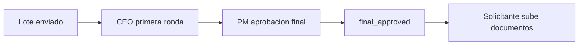

# ADR-016 El PM da la aprobación final

En el flujo de pagos de inversión se eliminó la aprobación final del CEO: el PM es el paso terminal que deja los pagos en `final_approved`.

## Contexto
El flujo por lotes tenía tres pasos de aprobación: CEO (primera ronda) → PM (revisión y ajuste de montos) → CEO (aprobación final, estado intermedio `final_pending`). La segunda intervención del CEO duplicaba la revisión y retrasaba la carga de documentos.

## Decisión
- El flujo pasa de 3 a 2 pasos: **CEO primera ronda → PM aprobación final**.
- `InvestmentPaymentReviewController::submit` deja los pagos directamente en `final_approved`, envía un correo consolidado al solicitante y un correo con PDF adjunto a los PMs.
- Se eliminaron las rutas `/investment-batch-final-approval/*` e `/investment-final-approval-session/*`, sus notificaciones y páginas React.
- Una migración promovió los lotes en `final_pending` a `final_approved` y anuló sus tokens.
- Textos: el PDF dice "Aprobador" (no "CEO aprobador"); el botón del PM es "Guardar aprobación final".

## Consecuencias
- Menos tiempo entre envío y carga de documentos.
- El estado `final_pending` ya no se genera; puede existir en el histórico.
- El PM concentra la última palabra sobre montos ajustados.

## Fecha
2026-07-14

## Fuentes
- Commit `84a109b`.

## Relacionado
- [[Indice de decisiones]] · [[Flujo de pago de inversion]] · [[Revision del PM]] · [[Aprobacion del CEO]] · [[ADR-006 Pagos de inversion por lotes semanales]]
