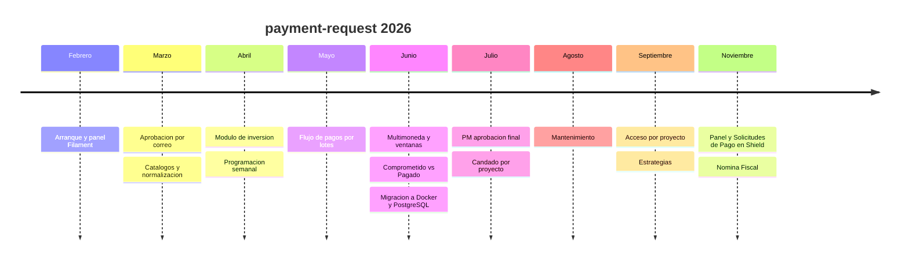

# Índice del historial

Historial de cambios del proyecto por mes, construido a partir de `git log`. Cada nota agrupa los commits por funcionalidad, con sha corto y fecha.

## Meses

| Mes | Commits | Temas principales |
|---|---|---|
| [[Historial 2026-02]] | 12 | Arranque: Laravel, Pest, Boost, panel Filament, flujo de aprobación legacy |
| [[Historial 2026-03]] | 32 | Aprobación por correo con token, catálogos con CSV, normalización, tipos de pago en BD, roles |
| [[Historial 2026-04]] | 69 | Módulo de inversión: solicitudes, consolidado, pagos, dashboard, programación semanal; endurecimiento de seguridad |
| [[Historial 2026-05]] | 56 | Importación masiva; flujo de pagos por lotes en 5 fases; notificaciones consolidadas |
| [[Historial 2026-06]] | 67 | Multimoneda, política de ventanas, multi-departamento, SAP, Comprometido vs Pagado, nuevo tema |
| [[Historial 2026-07]] | 13 | Comprobantes, PM con aprobación final, candado por proyecto, reportes ejecutivos |
| [[Historial 2026-08]] | 1 | Columna Departamento en la programación |
| [[Historial 2026-09]] | 3 | Cierre de proyectos, acceso por proyecto, Estrategias |
| [[Historial 2026-11]] | 2 | Panel y Solicitudes de Pago controlados desde Shield, tipo de pago Nómina Fiscal |
| **Total** | **255** | |

## Línea de tiempo

> [!info] Alcance
> Solo se documenta lo que está en `git log`. Los cambios operativos sin commit (infraestructura, correcciones de datos) no aparecen aquí; ver [[Produccion]] y el [[Indice de decisiones]].

## Cómo mantenerlo

1. Al cerrar un mes, crear `Historial AAAA-MM` con `git log --reverse --format='%h %ad %s' --date=short` filtrado al mes.
2. Agrupar por funcionalidad; una fila por commit con fecha y sha corto.
3. No incluir nombres de personas ni datos de producción aunque aparezcan en el mensaje del commit.
4. Enlazar los ADR cuando un commit materializa una decisión.

## Relacionado
- [[Indice de decisiones]] · [[Stack y versiones]] · [[Deploy]]
